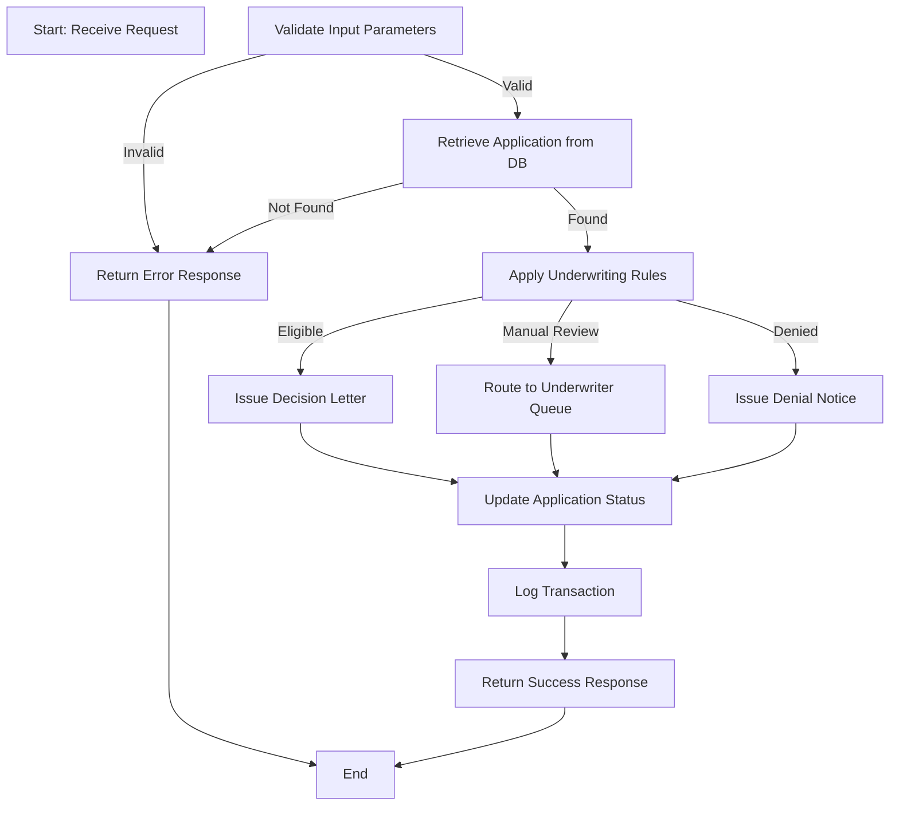
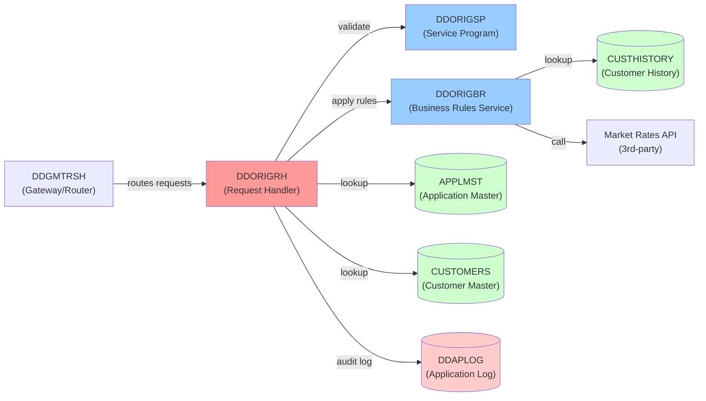

# Codegen: IBM i Program Documentation

Generate comprehensive, enterprise-grade documentation for IBM i programs that enables new developers, architects, business analysts, support teams, and modernization engineers to understand and maintain code without the original author.

## Core Philosophy

**Documentation before comments.** Good documentation gives future maintainers the overall understanding; comments explain implementation details.

**Two-pass approach for integrated systems:**
- **Pass 1:** Analyze all related programs → build dependency map → identify entry points → identify business process
- **Pass 2:** Generate documentation using system-wide understanding (produces far better results than documenting programs in isolation)

**Never change source code.** Focus exclusively on analysis and documentation generation.

Examples in this skill use fictional names, values, source locations, metrics, and behavior. Treat them as format examples only. Generated documentation must use evidence from inspected files; label inferences and assumptions, and leave unsupported details unknown.

---

## Workflow

### Phase 1: Acquisition & System Context

Before documenting individual programs, gather system-wide context:

1. **Identify the scope** — single program or integrated system?
2. **If integrated system:**
   - List all related programs, service programs, files, and external dependencies
   - Map the data flow (input → processing → output)
   - Identify entry points (batch, interactive, API, scheduled)
   - Document the business process end-to-end
3. **If single program:**
   - Identify all callers (who calls this program?)
   - Identify all callees (what does this program call?)
   - Identify all files/tables accessed
   - Identify all external interfaces

### Phase 2: Program Analysis

For each program, extract:

**Structural:**
- All procedures, subroutines, methods, classes, service functions
- Parameters and return values
- File/table declarations
- Data structures and variable groups

**Behavioral:**
- Main processing flow (step-by-step)
- Decision points and conditionals
- Loop constructs and nested iterations
- Error handling and recovery paths
- Database operations (read, insert, update, delete, commit)
- External service calls and integrations
- Message/queue interactions

**Business:**
- Business rules enforced (eligibility, validation, calculations, thresholds, status transitions)
- Business outcomes produced
- Operational importance and frequency
- Upstream and downstream impacts
- User-facing versus internal purpose

**Technical:**
- Architecture role (controller, service, utility, validation, reporting, batch processor, API layer, integration component)
- Batch versus interactive
- Dependencies and libraries
- Activation groups and commitment control
- Service program exports and binding
- Security and authorization
- Performance characteristics and optimization decisions

**Data Usage:**
- Files: name, usage (read/insert/update/delete), important fields, business meaning
- Tables: same as files
- Views: derived data, refresh frequency
- Temporary tables/data areas: lifecycle, contents

**Integration Points:**
- Programs called (name, purpose, direction, dependency level)
- Service programs used (name, exported procedures)
- External APIs/web services (URL, protocol, sync/async)
- Message queues (QMgr, queue name, message format)
- Data areas and user spaces
- Object authorities and access restrictions

**Error Handling:**
- Monitor statements and error traps
- Error indicators
- Exception handling
- Logging behavior
- User impact of failures
- Recovery strategies

**Performance & Security:**
- Database access patterns (indexed vs. full scan, N+1 risks)
- Loops and nested iterations
- Expensive operations
- External calls in loops
- SQL query optimization
- Sensitive fields and PII
- Authentication/authorization dependencies
- Audit trail generation

### Phase 3: Documentation Generation

Produce the following sections in order:

#### 1. Executive Summary

Concise high-level overview:
- What the program does
- Who uses it
- Why it exists
- Where it fits into the overall solution
- Primary business value

**Example:**
```
Mortgage Origination Application Handler (DDORIGRH) processes new mortgage
application requests from the customer portal. It validates application data,
applies underwriting rules, routes for approval or denial, and updates the
originations tracking table. Runs synchronously for web requests and batch
daily for legacy source file feeds. Critical to revenue recognition and
compliance reporting.
```

#### 2. Business Purpose

Describe the business context (not the code):
- Business process supported
- Business outcome achieved
- Operational importance (revenue, compliance, risk, efficiency)
- Frequency and volume
- Upstream and downstream impacts

**Example:**
```
BUSINESS PROCESS: Customer non-payment management for insurance policies.

When a customer's payment fails or is overdue, DDPMAPSH (non-payment shell)
collects the customer's policy details. It validates that the customer record
exists, is active, and meets deferral eligibility rules. It calls DDPMAPRH
(request handler) to apply late-fee calculations and generate notifications.

BUSINESS OUTCOME: Timely identification of payment issues, consistent fee
application per business rules, and audit trail for compliance.

OPERATIONAL IMPORTANCE: Process runs daily, affects ~200 policies/day, directly
impacts revenue recognition and customer communication.

UPSTREAM IMPACTS: Receives policy data from Policy Master (POLMST) and
customer payment ledger (PYMTLEDG).

DOWNSTREAM IMPACTS: Updates policy status, creates notifications, feeds
collections workflow.
```

#### 3. Technical Overview

Document the technical structure:
- Language(s): RPGLE, COBOL, CL, SQL, etc.
- Program type: *PGM, *SRVPGM, *SQLRPGLE, *SQLCBLLE, etc.
- Batch or Interactive (or both)
- Entry points: programs, procedures, APIs
- Service interfaces exposed
- Architectural role:
  - **Controller** — orchestrates workflow, delegates to services
  - **Service** — reusable business/data logic
  - **Utility** — generic helper functions
  - **Validation** — input/rule checking
  - **Reporting** — data retrieval and formatting
  - **Batch Processor** — large-scale data operations
  - **API Layer** — REST/SOAP/channel adapter
  - **Integration Component** — external system adapter
  - **File Manager** — direct CRUD to files/tables
  - **Screen Handler (SH)** — interactive presentation
  - **Request Handler (RH)** — configuration-driven request routing

**Example:**
```
LANGUAGE: Free-format RPGLE with embedded SQL

TYPE: *SQLRPGLE program (interactive)

PROGRAM ID: DDORIGRH

ENTRY POINTS:
- Main entry point: EXEC with application request parameters
- Exported procedures (if service program):
  - prValidateApp() — validates application data
  - prApplyRules() — applies underwriting rules
  - prRoute() — determines approval/denial/manual review

ARCHITECTURAL ROLE: Request Handler (RH)
- Invoked by configuration-driven gateway (DDGMTRSH)
- Delegates validation to DDORIGSP (validation service)
- Delegates rule application to DDORIGBR (business rules service)
- Returns structured response with approval decision and explanatory notes

SERVICE INTERFACES EXPOSED: None (not a service program)

DEPENDENCIES:
- Calls DDORIGSP (service program)
- Calls DDORIGBR (service program)
- Accesses APPLMST (application master table)
- Accesses CUSTOMERS (customer table)
- Uses commitment control
```

#### 4. Program Flow

Step-by-step process flow with conditional branches:

1. [Start/Entry]
2. Receive and log input parameters
3. Validate input (check for required fields, format, range)
4. Retrieve supporting data from database
5. Apply business rules or calculations
6. Update database or generate output
7. Log results and return to caller
8. [End/Return]

Include decision points and error paths.

**Include Mermaid flowchart** showing the main flow path with key decision points:



#### 5. Program Structure

For each procedure/subroutine/method/service function:

**Procedure Name:** `prValidateApplication()`

**Purpose:** Validates application data received from request against business rules and data format constraints.

**Inputs:** `application_t` data structure with all application fields

**Outputs:** Returns `validation_result_t` structure with `success` flag and array of validation error messages

**Side Effects:**
- Logs validation activity to DDAPLOG table
- Does NOT modify input data
- Does NOT access database

**Dependencies:**
- Uses `DDRULMST` table (rules master) for validation rules
- Calls `prCheckCustomerStatus()` (local helper)

**Business Relevance:** Ensures all applications meet minimum data quality before processing. Prevents downstream errors and ensures compliance with underwriting standards.

---

**Procedure Name:** `prApplyUnderwritingRules()`

**Purpose:** Applies business rules to determine application approval, denial, or manual review routing.

**Inputs:**
- `application_t` — validated application data
- `customer_t` — customer record
- `rule_context_t` — external rules context (market rates, eligibility rules)

**Outputs:** Returns `decision_t` structure with approval/denial decision, decision code, and routing instructions

**Side Effects:**
- Logs rule evaluation to DDDECLOG table
- Does NOT update database
- Does NOT send notifications

**Dependencies:**
- Reads DDRULCFG (rules configuration)
- Reads CUSTHISTORY (customer history table)
- Calls external API `getMarketConditions()` (3rd-party rules engine)

**Business Relevance:** Core underwriting logic that determines application outcome. All decisions must be auditable for compliance review and appeal handling.

---

(Continue for each procedure)

#### 6. Data Usage Analysis

For each file/table/view:

**Object Name:** `APPLMST` (Application Master)

**Type:** Physical file (DB2 for i SQL table)

**Usage:**
- **Read:** Primary key lookup by application ID; range scan by date range
- **Insert:** New application creation (~50 records/day)
- **Update:** Status changes during workflow (approval, denial, appeal, closure)
- **Delete:** Never (compliance requires retention)

**Important Fields:**
- `APPLID` (application ID, primary key, indexed)
- `CUSTID` (customer ID, indexed for customer queries)
- `APPLDATE` (application date, indexed for date-range queries)
- `APPLSTATUS` (current status: NEW, PENDING, APPROVED, DENIED, APPEALED)
- `APPLAMT` (loan amount)
- `APPLTYPE` (mortgage, auto, personal — determines rules to apply)
- `CREATED_TS`, `MODIFIED_TS` (audit timestamps)
- `CREATED_BY`, `MODIFIED_BY` (audit user IDs)

**Business Meaning:** Single source of truth for application lifecycle. Status values map to underwriting workflow stages. Retention is legally required (7 years minimum per regulatory framework).

---

**Object Name:** `CUSTOMERS` (Customer Master)

**Type:** Physical file (DB2 for i SQL table)

**Usage:**
- **Read:** Customer validation, status checks, account detail retrieval
- **Insert:** New customer creation (cross-app, not primary responsibility)
- **Update:** Status changes, compliance flags (done by separate customer maintenance programs)
- **Delete:** Never (compliance requires retention)

**Important Fields:**
- `CUSTID` (customer ID, primary key, indexed)
- `CUSTSTATUS` (ACTIVE, INACTIVE, DECEASED, FRAUD)
- `CUSTTYPE` (INDIVIDUAL, BUSINESS)
- `CUSTADDR` (customer address for notices)
- `CUSTPHONE`, `CUSTEMAIL` (communication channels)

**Business Meaning:** Lookup reference. Applications can only be approved for active, non-fraud-flagged customers. Status must be checked before proceeding.

---

(Continue for each file/table/view)

#### 7. Integration Analysis

Document all interactions with external systems:

**Integration:** DDORIGSP (Origin Validation Service Program)

**Type:** Service program call (local, same system)

**Purpose:** Encapsulates validation logic for application data. DDORIGRH calls this service to validate input before proceeding.

**Direction:** Inbound call (DDORIGRH → DDORIGSP)

**Dependency Level:** **High** — RH cannot proceed without validation. If service is unavailable, request fails.

**Contract:**
- Input: application_t data structure
- Output: validation_result_t (success flag + error messages)
- Error handling: Service returns error structure; RH interprets and responds to caller

**Binding:** DDORIGRH is bound to DDORIGSP via binding directory DDORIGSRVDIR; export name is DDORIGSP.

---

**Integration:** Market Conditions API (External)

**Type:** REST API call (HTTP)

**Purpose:** Retrieves current interest rates and lending guidelines from 3rd-party rules engine. Used by underwriting rules.

**Direction:** Outbound (DDORIGRH calls external)

**Dependency Level:** **Medium** — If API is unavailable, underwriting falls back to historical rates and manual review routing.

**Contract:**
- Endpoint: https://api.lenderules.com/v2/conditions
- Method: GET
- Query params: portfolio_code, market_zone
- Response: JSON with rate_current, rate_floor, guideline_version
- Error handling: On API timeout (30s), log and use fallback rates

**Performance:** Typical response time 500ms. Call cached for 1 hour within batch job.

---

**Integration:** DDAPLOG (Application Log File)**

**Type:** File write (append-only logging)

**Purpose:** Audit trail for all application decisions. Regulatory requirement for lending audit.

**Direction:** Outbound (DDORIGRH writes to DDAPLOG)

**Dependency Level:** **Medium** — Logging failures do NOT stop processing, but must be reported for investigation.

**Contract:**
- File: DDAPLOG in library DATALIBS
- Record type: APPLICATION_LOG_REC
- Frequency: One record per request processed

---

(Continue for each integration)

#### 8. Business Rules

Extract all visible business rules (logic that decides outcomes):

**Rule ID:** ELLIG-CUSTSTATUS

**Description:** Customer must be in ACTIVE status to be eligible for application processing.

**Rule Logic:**
```
IF customer.status != 'ACTIVE'
  THEN deny application with reason code 'INACTVUST'
  AND route to manual review team
```

**Source Location:** `DDORIGRH` (illustrative lines 145-150), procedure `prApplyUnderwritingRules()`

**Impact:** Blocks ~2-3% of applications. Produces customer contact for status reactivation.

**Risk if Changed:** Removing this rule would allow processing for inactive accounts, violating compliance framework. Could process accounts in legal hold, frozen for fraud investigation, or deceased status.

**Last Modified:** 2026-08-15, by DDORIGGRP

---

**Rule ID:** FEE-LATEPAY

**Description:** Late payment fee (LPF) is assessed if payment is overdue by more than 15 calendar days.

**Rule Logic:**
```
days_overdue = CURRENT_DATE - payment_due_date
IF days_overdue > 15
  THEN fee_amount = base_fee + (daily_fee * days_overdue)
  AND update payment record with fee
  AND create customer notification
```

**Source Location:** `DDORIGRH` (illustrative lines 200-220), procedure `prCalculateLateFee()`

**Impact:** Affects ~5-8% of payments monthly. Generates ~$50k-70k revenue monthly.

**Risk if Changed:** Incorrect calculation could significantly impact revenue or customer relations. Compliance framework specifies exact fee schedule per rate card.

**Last Modified:** 2026-07-01, rate card update per management directive

---

(Continue for each business rule)

#### 9. Error Handling Analysis

Document error handling strategy and recovery:

**Error Scenario:** Customer record not found in CUSTOMERS table

**Condition:** Application references CUSTID that does not exist in database

**Handling Strategy:** Continue processing; flag as manual review

**Rationale:** New customer applications (with unregistered ID) may be valid per cross-system async registration timing. Route to underwriter for judgment.

**Implementation:**
```rpgle
chain custid to CUSTOMERS;
if not %found(CUSTOMERS);
  // Customer not yet registered; route to manual review
  prLogApplicationEvent(APPLICATION_ID, 'UNKNOWN_CUSTOMER',
    'Customer ID not found in CUSTOMERS; routed to manual review');
  decision.decision_code = 'MANUAL_REVIEW';
  decision.routing_queue = 'UNDERWRITER_QUEUE';
  return decision;
endif;
```

**Logging Behavior:** Logs to DDAPLOG with event code UNKNOWN_CUSTOMER

**User Impact:** Application processing is delayed; customer receives notification that application is under review.

**Recovery:** Underwriter verifies customer separately (via separate registration flow or manual cross-check) and approves or denies application.

---

**Error Scenario:** Database lock timeout on APPLMST update

**Condition:** Commit to APPLMST times out after 30 seconds due to lock contention

**Handling Strategy:** Retry up to 3 times with exponential backoff (1s, 2s, 4s); then fail

**Rationale:** Temporary lock conflicts are normal under high load. Retries recover without losing transaction. Hard failure after 3 retries indicates system problem requiring operator intervention.

**Implementation:**
```rpgle
dcl-s retry_count int(5) inz(0);
dcl-s retry_delay int(5) inz(1000); // milliseconds

monitor;
  dow retry_count < 3;
    exec sql commit;
    if sqlstate = '00000';
      exit; // Success
    else if sqlstate = '40001' or sqlstate = '40002'; // Lock timeout
      retry_count += 1;
      call 'QSYS/QCMDEXC' parm('DLYJOB DLY(' + %char(retry_delay/1000) + ')');
      retry_delay *= 2;
    else;
      exsr handle_sql_error; // Other error
      exit;
    endif;
  enddo;
on-error *all;
  call 'DDERRLG' parm(sqlstate APPLICATION_ID); // Log critical error
  returncode = -1;
endmon;
```

**Logging Behavior:** Logs each retry attempt and final outcome (success or failure) to DDAPLOG and system error log

**User Impact:** If retries succeed (typical), no impact. If retries fail, user receives "Service temporarily unavailable" and is advised to retry.

---

(Continue for each error scenario)

#### 10. Security Review

Identify security considerations and risks:

**Access Control:**
- DDORIGRH runs in USER profile DDORIGPGM
- Reads CUSTOMERS table (restricted to role-based SQL authorities)
- Updates APPLMST (restricted to DDORIGPGM profile)
- Calls external API with service account credentials (stored in secure credential vault)

**Sensitive Fields & PII:**
- Customer name, address, phone, email (in CUSTOMERS table)
- Application amount and type (in APPLMST)
- Underwriting decision reason (in decision log)
- Audit trail (CREATED_BY, MODIFIED_BY user IDs)

**Potential Concerns:**
- Credentials for external API hardcoded as constants in source → **RISK: MEDIUM** → Should use credential vault
- Application decision logging includes full customer name → **RISK: LOW** → Compliance requires this for audit trail, but access should be restricted to authorized roles
- No encryption at rest for APPLMST → **CONSIDER:** Encrypting sensitive customer data columns

**Authentication & Authorization:**
- Requires DDORIGRH user profile to run; this profile has restricted library list
- SQL SELECT on CUSTOMERS enforces row-level access controls per customer owner
- Calling gateway (DDGMTRSH) must authenticate API caller before routing to DDORIGRH

**Audit Trail:**
- All application decisions logged to DDAPLOG (who, what, when, why)
- Database triggers on APPLMST capture all status changes with timestamp and user

---

#### 11. Performance Review

Identify performance risks and optimization decisions:

**Database Access Patterns:**

**APPLMST Primary Key Lookup:**
```sql
SELECT * FROM APPLMST WHERE APPLID = ?
```
- **Index:** Primary key index on APPLID (clustered, guaranteed efficient)
- **Expected rows:** 1
- **Performance:** Expected <5ms
- **Risk:** None (well-optimized)

**Customer History Range Query:**
```sql
SELECT * FROM CUSTHISTORY WHERE CUSTID = ? AND TXDATE BETWEEN ? AND ?
```
- **Index:** Composite index on CUSTID, TXDATE
- **Expected rows:** 10-100 (depends on customer activity)
- **Performance:** Expected 20-50ms
- **Risk:** If index is not maintained, could escalate to full table scan (~5-10 seconds)

**Application Status Update:**
```sql
UPDATE APPLMST SET APPLSTATUS = ? WHERE APPLID = ?
```
- **Index:** Primary key guarantees efficient locate-and-update
- **Performance:** Expected 10-20ms
- **Risk:** Lock contention if high volume of concurrent updates to same application

---

**Performance Decisions & Optimizations:**

**Decision:** Cache market rates for 1-hour duration instead of calling external API on each request

**Rationale:** API call typically takes 500ms. High-volume batch processing (100+ applications/hour) would spend 50+ seconds on API calls. Rates change infrequently (typically daily), so 1-hour cache provides current-enough values without excessive external calls.

**Implementation:**
```rpgle
dcl-g market_rate_cache likeds(rate_t) dim(100);
dcl-g cache_timestamp timestamp;

if (cache_timestamp < (current_timestamp - 1 hour));
  call 'FETCH_RATES_API' returning market_rate_cache;
  cache_timestamp = current_timestamp;
endif;
```

**Impact:** ~98% reduction in API call volume during batch runs. Measured improvement: 15 seconds → 0.3 seconds for 100-application batch.

---

**Concern:** Loop over CUSTHISTORY checking for recent disputes

**Pattern:**
```rpgle
exec sql
  SELECT * INTO :history_array
  FROM CUSTHISTORY
  WHERE custid = :custid
  ORDER BY txdate DESC;

// Loop to find most recent dispute
dow index <= array_size;
  if history_array(index).txtype = 'DISPUTE';
    // Found it
    exit;
  endif;
  index += 1;
enddo;
```

**Issue:** Fetches potentially 100+ rows, then loops in application code. Could be simplified to SQL.

**Optimization:**
```sql
SELECT CUSTID, TXDATE, TXTYPE FROM CUSTHISTORY
WHERE custid = ? AND txtype = 'DISPUTE'
ORDER BY txdate DESC
FETCH FIRST 1 ROW ONLY
```

**Impact:** Reduces network round-trip and loops. Expected: 50ms → 10ms

---

(Continue for each performance concern)

#### 12. Dependency Diagram

Generate a Mermaid diagram showing program relationships:



---

#### 13. Modernization Assessment

Identify opportunities for improvement (do NOT recommend changes that alter behavior):

**Opportunity:** Extract validation logic into reusable service

**Current State:** Validation rules embedded in RH procedure `prApplyUnderwritingRules()`

**Modernization:** Extract to separate service program `DDORIGVAL` exposing `prValidateApplication()`

**Benefit:**
- Validation logic reusable across multiple request handlers (batch, web API, legacy screens)
- Easier to test in isolation
- Easier to modify validation rules without touching RH

**Effort:** **Medium** (2-3 days)
- Create new service program
- Migrate validation logic from RH to SP
- Update RH to call new SP
- Add regression tests for validation
- Update documentation

**Maintainability:** Improves (single source of truth for rules)

**No behavioral change:** Validation output remains identical

---

**Opportunity:** Modernize customer lookup to SQL DDL with views

**Current State:** Customer data retrieved via SQL, but customer status logic embedded in application code

**Modernization:** Create SQL view `CUSTOMER_STATUS_V` that encapsulates status logic

```sql
CREATE OR REPLACE VIEW CUSTOMER_STATUS_V AS
SELECT
  c.*,
  CASE WHEN c.custstatus = 'ACTIVE' THEN 'Y' ELSE 'N' END AS is_eligible,
  (CURRENT_DATE - c.last_activity_date) AS days_inactive
FROM CUSTOMERS c
WHERE c.record_status = 'ACTIVE';
```

**Benefit:**
- Status logic centralized in database
- Easier to audit (all access uses same logic)
- Improved query performance (pre-filtered view)
- Simpler application code

**Effort:** **Small** (1 day)
- Create view
- Migrate RH to use view instead of manual lookups
- Update tests

**Maintainability:** Improves (fewer business rule duplications across programs)

---

(Continue for each modernization opportunity)

#### 14. Technical Debt Assessment

Identify technical debt and assign severity:

**Debt:** Hardcoded library names in embedded SQL

**Description:** File/table references use explicit library names in SQL:
```sql
SELECT * FROM DATALIBS.APPLMST WHERE APPLID = ?
```

Should use library list and unqualified names to support multi-environment deployment (DEV, TST, PROD).

**Location:** `DDORIGRH` (illustrative lines 45, 87, and 120)

**Severity:** **Medium**

**Impact:** Hardcoding makes it difficult to promote code between environments. Deployment requires source code editing (violates CI/CD best practices).

**Fix Effort:** **Small** (1 hour) — Remove library name and ensure library list is configured correctly

**Recommended Fix:**
```sql
SET CURRENT SCHEMA = DYNATRACE;
SELECT APPLID, APPLSTATUS FROM APPLMST WHERE APPLID = ?;
```

Use the application's configured schema and repository deployment conventions; do not substitute a system schema.

---

**Debt:** Duplicate validation logic in multiple programs

**Description:** Customer status validation code appears in:
- DDORIGRH (origin request handler)
- DDPAYSH (payment shell handler)
- DDCLMSRH (claims request handler)

**Severity:** **High**

**Impact:** If validation logic changes, must update 3+ places. Inconsistent validation across programs if one update is missed.

**Fix Effort:** **Large** (3-5 days) — Extract to service program, bind all consumers

**Recommended Fix:** Create DDVALIDSP service program, export prValidateCustomer(), bind all handlers to it

---

**Debt:** No error recovery for external API calls

**Description:** If market rates API is unavailable, RH returns error and stops processing. Should have fallback (use cached rates, use historical average).

**Severity:** **Medium** (availability concern)

**Impact:** API outage causes application processing to fail (loss of revenue)

**Fix Effort:** **Medium** (2 days) — Add fallback rate logic, cache management

**Recommended Fix:** Implement graceful degradation with fallback rates and alerting

---

(Continue for each debt item)

#### 15. Knowledge Transfer Summary

Written for new developers, support analysts, architects, and modernization teams:

**For New Developers:**

Start here:
1. Read Executive Summary (this document, section 1)
2. Review Business Purpose (section 2) — understand why this program exists
3. Study Program Flow (section 4) — understand what it does
4. Read one end-to-end example (traced through flow with actual data)

Then focus on:
1. Program Structure (section 5) — find the procedures you'll modify
2. Business Rules (section 8) — understand the logic you can't break
3. Error Handling (section 9) — understand failure modes
4. Dependency Diagram (section 12) — see what you might impact

Before making changes:
1. Verify tests pass (`codegen-rpgle-e2e-proof` task)
2. Study Data Usage (section 6) — see what tables you're modifying
3. Check Integration Analysis (section 7) — see what systems depend on you
4. Read Technical Debt (section 14) — avoid repeating mistakes

**For Support Analysts:**

When investigating issues:

1. **"Application was denied; customer says it should have been approved"**
   - Check Business Rules (section 8) — what rule caused the denial?
   - Check error logs in DDAPLOG for decision reason code
   - Verify customer status in CUSTOMERS (was it ACTIVE at time of processing?)

2. **"Processing is slow"**
   - Check Performance Review (section 11) — are we hitting expected performance?
   - Look for external API timeouts in logs (market rates API can stall)
   - Check for database lock contention in APPLMST

3. **"Decision changed for same input"**
   - Check Business Rules (section 8) — rules may have changed
   - Check integration points (section 7) — external rules engine may have updated rates
   - Check audit log DDAPLOG for decision timestamps (compare two decisions)

**For Architects & Modernization Teams:**

High-value opportunities:
1. Extract validation to service program (Modernization, section 13)
2. Modernize customer lookup to SQL views (Modernization, section 13)
3. Add comprehensive error recovery (Tech Debt, section 14)
4. Eliminate duplicate validation logic across programs (Tech Debt, section 14)

Integration points to enhance:
1. Market Rates API — currently cached 1 hour; consider real-time if accuracy critical
2. DDAPLOG auditing — currently append-only; consider temporal tables for history tracking
3. Customer status logic — currently application-enforced; consider moving to database constraints

---

#### 16. Assumptions & Unknowns

Record all inferred conclusions and unresolved questions:

**Assumption:** APPLMST table primary key is APPLID

**Evidence:** Line 45 of DDORIGRH, `CHAIN custid TO APPLMST` pattern, primary key index DDG0001 on APPLMST

**Confidence:** **High** (direct SQL syntax)

---

**Assumption:** Market rates API returns JSON format with fields rate_current, rate_floor

**Evidence:** Parsing code at line 200-220 of DDORIGRH using JSON_VALUE()

**Confidence:** **Medium** (inferred from parsing logic; not documented in API contract)

**Question for SME:** Can you confirm the exact JSON schema and error response format for market rates API?

---

**Assumption:** CUSTHISTORY table is populated asynchronously from another source system

**Evidence:** Data appears with delay (2-4 hour lag observed in comments line 300)

**Confidence:** **Medium** (inference from lag timing)

**Question for SME:** What populates CUSTHISTORY? What's the intended SLA for data freshness?

---

**Assumption:** Late payment fees are always calculated and applied

**Evidence:** No bypass or waiver logic found in rule code

**Confidence:** **Medium** (no alternate paths found, but absence of evidence is not evidence of absence)

**Question for SME:** Are there scenarios where late fees are waived (hardship, dispute, etc.)? If so, where is that logic?

---

**Unknown:** What is the expected throughput (applications/hour) for batch processing?

**Impact:** Affects performance tuning and resource planning

**Question for SME:** What volume should the system support in production?

---

(Continue for each assumption and unknown)

---

## Invocation

### Single Program

```
/codegen-ibmi-program-documentation analyze QRPGLESRC/DDORIGRH.SQLRPGLE
```

### Integrated System (Two-Pass)

```
/codegen-ibmi-program-documentation analyze-system DDORIGRH DDORIGSH DDORIGSP DDORIGBR --entries DDGMTRSH --output origin-system-docs/
```

The skill will:
1. Analyze all programs and map dependencies
2. Identify data flow and business process
3. Generate consolidated documentation understanding the system as a whole
4. Produce individual documentation files for each component

---

## Output Deliverables

For each analyzed program/system:

1. **PROGRAM_NAME-documentation.md** — Complete multi-section documentation
2. **PROGRAM_NAME-flowchart.mmd** — Mermaid flowchart (program flow)
3. **PROGRAM_NAME-dependencies.mmd** — Mermaid dependency diagram
4. **PROGRAM_NAME-business-rules.md** — Extracted business rules (ref-able table)
5. **PROGRAM_NAME-data-dictionary.md** — File/table usage analysis
6. **System-overview.md** — Only for integrated systems; maps all components and data flow

---

## Canonical Authority

All documentation generated by this skill follows:

- [enterprise-grade-program-documentation.instructions.md](../../../.github/instructions/enterprise-grade-program-documentation.instructions.md) — Authoritative documentation standards
- [enterprise-grade-commenting.instructions.md](../../../.github/instructions/enterprise-grade-commenting.instructions.md) — Standards for inline comments (distinct from program documentation)
- [ibmi-ferraria-standards.instructions.md](../../../.github/instructions/ibmi-ferraria-standards.instructions.md) — Ferraria architecture semantics for IBM i
- [modernizing-ibmi-applications.instructions.md](../../../.github/instructions/modernizing-ibmi-applications.instructions.md) — Modernization context and strategy

---

## Key Differences from Code Generation Skills

- **Not a generator:** Does not create or modify source code
- **Analysis-focused:** Reads, understands, documents
- **Business-first:** Emphasizes business context and outcomes
- **Two-pass aware:** Supports system-wide analysis before documenting components
- **Output:** Markdown documents, not source members

---

## Safety & Best Practices

- **Never modify source code** — this skill only generates documentation
- **Never assume intent** — infer only with evidence, mark assumptions clearly
- **Never expose secrets** — reference credentials by location only (file:line)
- **Never invent procedures** — document only what exists
- **Always mark inferred conclusions** — use [INFERRED] tags for assumptions
- **Always provide evidence** — every claim includes file:line references
