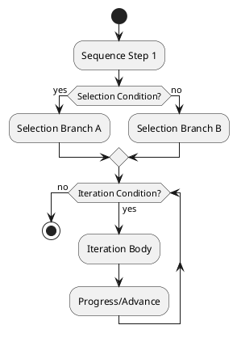

## Mapping Jackson structures to PlantUML

This guide maps Jackson primitives to practical PlantUML activity notation.

### Scope warning

PlantUML activity diagrams are representational mappings, not exact Jackson
notation. If exact Jackson semantics are required, keep the canonical Jackson
text structure adjacent to the diagram.

### Mapping table

| Jackson construct | PlantUML shape | Required annotation |
| --- | --- | --- |
| Sequence | `:action;` chain | preserve order |
| Iteration | `while (...) is (...)` | show termination condition |
| Selection | `if (...) then (yes)` | show explicit predicate |

### Mapping rules

- Keep one Jackson node to one visible step/decision where possible.
- Keep branch labels business-meaningful and testable.
- Put loop progression/update inside loop body.
- Show explicit end/stop path.
- Note any semantic loss in a short `limitations` note.

### Skeleton pattern

### Recommended companion block

Include under each diagram:

- Canonical Jackson text form:
- Mapping assumptions:
- Known representational limitations:
