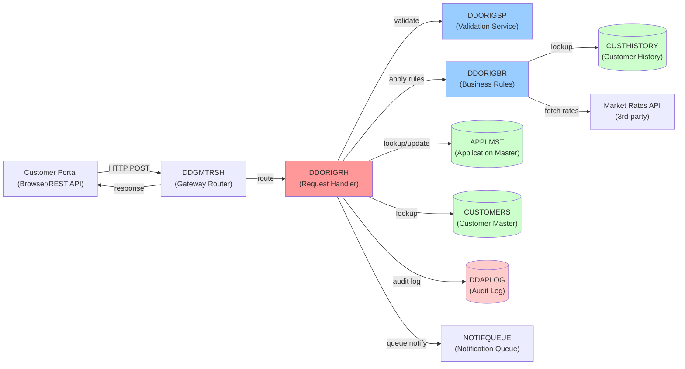

# Enterprise-Grade Program Documentation Standards — Canonical Authority

**Canonical Reference** — All IBM i program documentation follows these standards.

**Scope:** Complete program/artifact documentation (multi-section, comprehensive analysis)

**Distinct from:** `enterprise-grade-commenting.instructions.md` (inline comments within source code)

**Version:** 2.0
**Last Updated:** 2026-08-29
**Status:** Canonical authority for program documentation

---

## Core Documentation Philosophy

### Principle 1: Documentation Before Comments

**Good documentation** gives future maintainers the overall understanding.

**Good comments** explain implementation details and non-obvious decisions.

**Order of priorities:**
1. Excellent program-level documentation (multi-section analysis)
2. Clear code (obvious intent from structure and naming)
3. Targeted comments (WHY, not WHAT; see enterprise-grade-commenting.instructions.md)

**Anti-pattern:** Substituting comments for documentation. Comments inside a procedure explain the procedure; documentation outside explains the program.

### Principle 2: Document for Future Maintainers, Not the Original Author

Documentation exists so that a new developer, architect, support analyst, or modernization engineer can understand and safely change the code without requiring the original author.

**Ask:** What does a new person need to know to maintain this?

**Answer:**
- Business purpose (why does this program exist?)
- Business outcomes (what does the business depend on this program to do?)
- Technical design (how is it built?)
- Program flow (what are the main steps?)
- Data usage (what files/tables does it touch and why?)
- Integration points (what does it call? what calls it?)
- Business rules (what logic is non-obvious or risky to change?)
- Error handling (what can go wrong and how is it handled?)
- Dependencies (what would break if this changed?)

**Never assume:** The reader knows the business context, the company's architecture patterns, the history of this program, or why certain choices were made.

### Principle 3: Two-Pass Analysis for Integrated Systems

For integrated systems (multiple programs working together), use two-pass analysis:

**Pass 1:** Analyze all related programs together
- Map dependencies (caller → callee)
- Trace data flow (input → processing → output)
- Identify entry points (batch, interactive, API, scheduled)
- Understand the business process end-to-end

**Pass 2:** Generate documentation with system-wide understanding
- Document each component in context of the whole system
- Explain how components interact
- Clarify which program owns which responsibility
- Identify risks that only appear when viewing components together (data race conditions, circular dependencies, missing error propagation)

**Benefit:** Documentation reflects actual design, not isolated program analysis.

### Principle 4: Infer Only With Evidence; Mark Assumptions

If intent cannot be determined from code and comments:

**Document the assumption** — state what you inferred and why

**Mark confidence level** — High (direct evidence), Medium (strong inference), Low (assumption)

**Never fabricate functionality** — if you don't know, ask.

**Tag inferred conclusions** — `[INFERRED]` prefix signals that the reader should verify with SMEs.

**Example:**
```
[INFERRED] Assumption: APPLMST table primary key is APPLID

Evidence:
- Line 45 of DDORIGRH uses CHAIN applid TO APPLMST
- Index DDG0001 exists on APPLMST(APPLID)
- SQL SELECT statements use WHERE APPLID = ?

Confidence: High (direct syntax evidence)

Outstanding question for SME: Can you confirm the PK is APPLID?
```

---

## When to Document

### Always Document

**All production programs:**
- Programs in active use or likely to be maintained
- Programs in data flows or integration points
- Programs with business rule logic
- Programs that affect revenue, compliance, or customer experience

**All service programs and modules:**
- Exported procedures and their contracts
- Data structures and their fields
- Error handling and success criteria

**All significant data objects:**
- Tables, views, logical files
- Temporary tables with non-obvious purpose
- Data areas and user spaces with application semantics

### Document Before

**Modernization:** Before modifying legacy code, document current behavior (as-is). This becomes the spec for ensuring behavior is preserved.

**Refactoring:** Before extracting functions or creating services, document the logic being extracted (reduces risk of behavioral change).

**Integration:** Before creating new integration points, document current data contracts and error handling.

### Document After

**New feature implementation:** After code is working and tested, generate documentation explaining the design and business rules.

**Bug fixes:** After fixing a non-obvious bug, document what went wrong and how the fix prevents recurrence.

**Performance tuning:** After optimizing code, document the optimization decision and performance trade-offs.

---

## Documentation Structure (16 Sections)

Use this structure for all program documentation. Adapt for smaller programs (combine sections if minimal content) or larger systems (add sub-sections per component).

### 1. Executive Summary

**Length:** 3-4 sentences

**Content:**
- What the program does (one sentence)
- Who uses it and why (one sentence)
- Business value or operational importance (one sentence)
- Where it fits in the overall system (one sentence, if needed)

**Example:**
```
DDORIGRH (Mortgage Origination Request Handler) processes new mortgage
application requests from the customer portal. It validates application data,
applies underwriting rules, and routes applications for approval, denial, or
manual review. This is the core request handler in the mortgage origination
system, running synchronously for web requests and batch for legacy feeds.
```

**Never:**
- Describe syntax or implementation
- List all features
- Repeat the program name excessively

### 2. Business Purpose

**Length:** 300-500 words

**Content:**
- Business process supported
- Business outcomes achieved
- Operational importance (revenue, compliance, efficiency, risk)
- Frequency and volume
- Upstream impacts (what provides input?)
- Downstream impacts (what depends on output?)

**Example:**
```
BUSINESS PROCESS
When a customer submits a mortgage application through the web portal,
DDORIGRH receives the request payload. It validates application completeness,
checks customer eligibility, applies underwriting rules, and produces a
decision (approved, denied, or manual review).

BUSINESS OUTCOME
Applicants receive mortgage decisions within 1 business day (vs. 5+ day
manual review). The business captures 100% of application completeness errors
at intake (vs. discovering them during manual review). Underwriting rules are
consistently applied (vs. per-person variation).

OPERATIONAL IMPORTANCE
- Revenue: Originations are the primary revenue stream (~$50M annually)
- Compliance: All decisions must be auditable per regulatory framework
- Efficiency: Reduces manual review workload from 5 days to 2 hours
- Risk: Incorrect approvals directly impact default risk portfolio

FREQUENCY & VOLUME
- Peak: 500+ applications/day during spring/summer (home buying season)
- Off-peak: 50-100 applications/day otherwise
- Annual: ~100k applications processed

UPSTREAM IMPACTS
- Receives input from: Customer portal (REST API), batch file feed from
  legacy system (CL DDORIGSBM), manual entry via 5250 screens (DDORIGSHE)
- Depends on: CUSTOMERS master (customer status), APPLMST (previous
  applications), external rules engine (market conditions)

DOWNSTREAM IMPACTS
- Feeds: Collections process if denied (DDCLMSBM)
- Feeds: Disbursement if approved (DDORIGDISBM)
- Updates: APPLMST status, CUSTOMERS audit trail
- Impacts: Revenue recognition (time application approved vs. disbursed)
```

### 3. Technical Overview

**Length:** 150-250 words

**Content:**
- Language and type (*PGM, *SRVPGM, *SQLRPGLE, etc.)
- Batch or interactive (or both, and when)
- Entry points (programs, procedures, APIs)
- Architectural role (controller, service, handler, utility, etc.)
- Key dependencies and libraries

**Example:**
```
LANGUAGE: Free-format RPGLE with embedded SQL
TYPE: *SQLRPGLE program (interactive)
PROGRAM ID: DDORIGRH

ENTRY POINTS
- Main program entry: Called by DDGMTRSH (gateway router) with application
  request parameters
- Called as: CALL 'DDORIGRH' PARM(request_json response_json error_code)

ARCHITECTURAL ROLE: Request Handler (RH)
- Positioned in the request/response pipeline after the gateway (DDGMTRSH)
  routes requests
- Delegates validation to DDORIGSP (service program)
- Delegates business rule application to DDORIGBR (service program)
- Returns structured response with decision and explanatory data
- Logs all decisions to DDAPLOG for audit trail

BATCH vs. INTERACTIVE
- Primary: Interactive (web requests, ~400/day)
- Secondary: Can be called from batch job DDORIGSB (overnight feeds, ~100/night)
- Behavior identical in both modes

KEY DEPENDENCIES
- DDORIGSP (validation service program)
- DDORIGBR (business rules service program)
- Binding directory: DDORIGSRVDIR
- Library: DDAPPLIB (CUSTOMERS, APPLMST tables)
```

### 4. Program Flow

**Length:** 200-400 words + Mermaid diagram

**Content:**
- Step-by-step flow (1-10 steps typically)
- Decision points with conditions
- Error paths
- Mermaid flowchart showing main path with key decisions

**Example:**
```
MAIN PROCESS FLOW

1. Start: Receive request
   - Receive application request from caller (JSON)
   - Log request receipt with timestamp and request ID

2. Validate input
   - Check required fields (name, SSN, amount, property)
   - Check data format (SSN is 9 digits, amount is numeric)
   - Check for invalid values (amount < $50k or > $10M)
   → If validation fails, return error response (section 9)

3. Retrieve customer record
   - Lookup customer in CUSTOMERS by SSN
   → If not found, route to manual review (customer doesn't exist yet)
   → If found but inactive, return error (customer status check)

4. Retrieve customer history
   - Get last 12 months of transactions from CUSTHISTORY
   - Count disputes, delinquencies, defaults

5. Apply underwriting rules
   - Call DDORIGBR service program with customer + history
   - Receive decision (APPROVED, DENIED, MANUAL_REVIEW)
   - Receive decision reason code and explanation text

6. Update database
   - Commit application record to APPLMST with decision
   - Update CUSTOMERS audit trail with latest decision timestamp

7. Generate notifications
   - Call notification service (DDNOTFSRV) to send decision letter
   - Notification sent asynchronously (not awaited)

8. Log transaction
   - Write audit record to DDAPLOG with full transaction details

9. Return response
   - Compose JSON response with decision, reason, next steps
   - Return to caller

10. End
```

**Flowchart:**
```mermaid
flowchart TD
  A["1. Receive Request"]
  B["2. Validate Input"]
  C["3. Retrieve Customer"]
  D["4. Retrieve History"]
  E["5. Apply Rules"]
  F["6. Update Database"]
  G["7. Generate Notifications"]
  H["8. Log Transaction"]
  I["9. Return Response"]
  Z["End"]

  E_Err["Error: Invalid Input"]
  C_Err["Error or Manual Review:<br/>Customer Not Found"]

  A → B
  B -->|Invalid| E_Err
  E_Err → Z
  B -->|Valid| C
  C -->|Not Found| C_Err
  C_Err → Z
  C -->|Found & Active| D
  D → E
  E → F
  F → G
  G → H
  H → I
  I → Z

  style E_Err fill:#ffcccc
  style C_Err fill:#ffcccc
```

### 5. Program Structure

**Length:** 200-500 words (or reference separate document if very large)

**Content:**
For each significant procedure/function/method:
- Name
- Purpose (one sentence)
- Inputs (parameters, data structures)
- Outputs (return value, structures)
- Side effects (database changes, logging, external calls)
- Dependencies (what does it call?)
- Business relevance (why does this matter?)

**Example:**
```
PROCEDURE: prValidateApplication()

Purpose: Validates application data against business rules and data format
requirements. Does not modify input.

Inputs:
- application_t: Data structure with all application fields
  - appAmount (required, numeric, $50k-$10M)
  - appType (required, MORTGAGE|HELOC|REFI)
  - custSSN (required, 9-digit format)
  - propertyZipCode (required, 5-digit format)
  - ...see data dictionary for full structure

Outputs:
- validation_result_t: Structure with:
  - success (boolean): T if valid, F if validation failed
  - error_count (int): Number of validation errors
  - errors[10]: Array of error messages, one per failed validation

Side Effects:
- Logs validation event to DDAPLOG (for audit trail)
- Does NOT modify input data
- Does NOT access database

Dependencies:
- Reads DDRULMST table (validation rules configuration)
- Calls prCheckSSNFormat() (local helper procedure)
- Calls prCheckAmountRange() (local helper procedure)

Business Relevance:
Critical control point that ensures all applications meet minimum quality
before proceeding. Validation failures are primary reason for quick denials
(e.g., incomplete application information). If validation is bypassed,
downstream systems receive garbage data and rules fail unpredictably.
```

### 6. Data Usage Analysis

**Length:** 300-600 words (or reference separate data dictionary document)

**Content:**
For each file/table/view accessed:
- Object name and type (PF, LF, view, temporary)
- Usage pattern (READ, INSERT, UPDATE, DELETE)
- Important fields (names, business meaning)
- Access patterns (indexed lookup, range scan, full scan)
- Performance notes

**Example:**
```
TABLE: APPLMST (Application Master)

Type: DB2 for i physical file (SQL table)

Usage:
- READ: Primary key lookup by APPLID (primary path)
         Range scan by APPLYDATE (reporting/batch)
- INSERT: One record per application submission (~500/day peak)
- UPDATE: Status changes during workflow (NEW → APPROVED/DENIED/MANUAL)
- DELETE: Never (compliance retention requirement: 7 years)

Important Fields:
- APPLID (primary key, indexed, auto-generated sequence)
- CUSTID (customer ID, indexed for customer lookups)
- APPAMT (application amount, business-critical for rules)
- APPTYPE (application type: MORTGAGE|HELOC|REFI, determines rule set)
- APPLDATE (application date, indexed for time-based queries)
- APPLSTATUS (current status: NEW, PENDING, APPROVED, DENIED, APPEALED,
  CLOSED) — workflow state machine
- DECISION_CODE (reason for approval/denial, e.g., INCOME_LOW, CREDIT_POOR,
  APPROVED, MANUAL_REQUESTED)
- CREATED_TS, MODIFIED_TS (audit timestamps, automatically maintained)
- CREATED_BY, MODIFIED_BY (audit user IDs, for compliance tracking)

Business Meaning:
Single source of truth for application lifecycle. Status values directly
map to workflow stages. Application data is immutable after submission
(modifications are tracked in APPLHISTORY, not in APPLMST itself).

Access Patterns:
- Primary key lookup: APPLID (typical: <5ms, 1 row)
  "SELECT * FROM APPLMST WHERE APPLID = ?"
  Uses primary key index, guaranteed efficient

- Range scan by date: APPDATE range + status filter (~50-100ms, 50-200 rows)
  "SELECT * FROM APPLMST WHERE APPDATE BETWEEN ? AND ?
    AND APPLSTATUS IN ('APPROVED', 'DENIED')"
  Uses composite index on (APPDATE, APPLSTATUS) if available

Performance Notes:
- Primary key access is optimal; no tuning needed
- Range scan can degrade if indexes not maintained; monitor REORG schedule
- Inserts are single-row and fast; no batch insert optimization attempted
- Updates typically single-row (one application ID); low contention risk
```

### 7. Integration Analysis

**Length:** 200-400 words (or reference separate integration document)

**Content:**
For each external integration (program call, API, file, queue, etc.):
- System/program name
- Purpose
- Direction (inbound/outbound)
- Dependency level (High/Medium/Low)
- Success/error contract
- Performance characteristics
- Known limitations or concerns

**Example:**
```
INTEGRATION: DDORIGSP (Origin Validation Service Program)

Type: Service program call (local, same system)

Purpose: Encapsulates validation logic for application data. DDORIGRH calls
this service to validate input before proceeding to business rules.

Direction: Outbound (DDORIGRH calls DDORIGSP)

Dependency Level: HIGH
- RH cannot proceed without validation result
- If service is unavailable, request fails immediately
- No fallback or graceful degradation

Contract:
- Input: application_t data structure
- Output: validation_result_t structure with success flag and error messages
- Error handling: Service returns error structure; RH interprets and
  responds to caller
- Success criteria: success = true means validation passed
- Failure criteria: success = false, check errors[] for specific failures

Performance:
- Typical call time: 5-20ms (all in-memory validation)
- Cached rules: Validation rules loaded once per job activation
- Expected throughput: 1000+ calls/second (no bottleneck)

Binding:
- DDORIGRH is bound to DDORIGSP via binding directory DDORIGSRVDIR
- Binding is static (link-time), not dynamic
- If DDORIGSP is recompiled, DDORIGRH must be rebound

Known Limitations:
- Validation rules are hard-coded; to change, must recompile DDORIGSP
- Consider extracting rules to database (DDRULMST) for runtime configurability
```

### 8. Business Rules

**Length:** 300-600 words (or reference separate business rules catalog)

**Content:**
For each visible business rule (logic that affects outcomes):
- Rule ID
- Description (one sentence)
- Rule logic (pseudocode or actual code snippet)
- Source location (file and line range)
- Business impact (who cares? what happens if this rule changes?)
- Risk if removed (why does this rule exist?)
- Last modified date and reason

**Example:**
```
RULE ID: ELLIG-CUSTSTATUS

Description: Customer must be in ACTIVE status to be eligible for application
processing.

Rule Logic:
IF customer.status != 'ACTIVE'
  THEN return DENIED with reason code 'INACTVUST'
  AND route to MANUAL_REVIEW queue
  AND log event 'CUSTOMER_INACTIVE'

Source Location:
- File: QRPGLESRC/DDORIGRH.SQLRPGLE
- Lines: 145-155 in procedure prCheckCustomerStatus()

Business Impact:
- Blocks ~2-3% of applications annually (~2,500-3,000 applications)
- Typical outcome: Customer is directed to reactivate account elsewhere
- For customers in fraud investigation or legal hold: Blocks processing
  intentionally
- Revenue impact: None (blocks unqualified applications)
- Customer experience impact: Generates customer service inquiry (why was I denied?)

Risk if Removed:
- Applications could be processed for inactive accounts
- Inactive accounts may be in legal hold, frozen for fraud investigation,
  or deceased status
- Violates compliance framework (regulatory requirement to verify customer status)
- Could process accounts subject to sanctions or legal restrictions

Last Modified:
- 2026-08-15 by user DDORIGGRP
- Reason: Added explicit check for FRAUD flag after security audit

Related Rules:
- See also: ELLIG-FRAUD (check customer fraud flag)
- See also: ELLIG-SANCTIONS (check against sanctions list)
```

### 9. Error Handling Analysis

**Length:** 200-400 words (or reference separate error handling guide)

**Content:**
For each error scenario (what can go wrong):
- Scenario name
- Condition (when does this error occur?)
- Handling strategy (what does the program do?)
- Rationale (why handle it this way vs. alternatives?)
- Logging behavior (what gets logged?)
- User impact (what does the end user experience?)
- Recovery strategy (how does the system recover?)

**Example:**
```
ERROR SCENARIO: Customer Record Not Found

Condition: Application references CUSTID that does not exist in CUSTOMERS
table. May occur if:
- Customer ID was mis-typed
- New customer is applying without prior registration
- Cross-system timing issue (customer registered in one system but not
  synced to this system)

Handling Strategy: Route to manual review (do not deny outright)

Rationale: Denying automatically would reject legitimate new-customer
applications due to timing issues. Manual review allows underwriter to
verify customer separately and approve if valid.

Implementation:
```rpgle
chain custid to CUSTOMERS;
if not %found(CUSTOMERS);
  // Customer not in master file; route to manual review
  prLogApplicationEvent(APPLICATION_ID, 'UNKNOWN_CUSTOMER',
    'Customer ID ' + %char(custid) + ' not found in CUSTOMERS');

  decision.decision_code = 'MANUAL_REVIEW';
  decision.routing_queue = 'UNDERWRITER_QUEUE';
  decision.manual_reason = 'Customer not found in master file';

  return decision;
endif;
```

Logging Behavior:
- Event code: UNKNOWN_CUSTOMER
- Severity: WARNING
- Logged to: DDAPLOG table
- Includes: Application ID, customer ID, timestamp, processing program
- Audit trail preserved for compliance review

User Impact:
- Application processing is delayed (routed to manual review queue)
- Customer receives notification: "Your application is under review by our
  underwriting team"
- Underwriter investigates and either approves or denies application

Recovery Strategy:
1. Underwriter checks customer registration status in separate system
2. If customer exists elsewhere, underwriter manually updates CUSTOMERS
   reference
3. Underwriter resubmits application for processing with updated customer ID
4. Application proceeds through normal approval flow
5. If customer does not exist, underwriter denies application
```

### 10. Security Review

**Length:** 200-300 words

**Content:**
- Access control (who can run this? what profile runs it?)
- Sensitive fields (PII, regulated data)
- Potential security concerns
- Authentication/authorization dependencies
- Audit trail generation
- Data encryption considerations

**Example:**
```
ACCESS CONTROL

Execution Profile: DDORIGRH program runs under USER profile DDORIGPGM

- DDORIGPGM has restricted library list (DDAPPLIB, QSYS only)
- DDORIGPGM has limited object authorities (read CUSTOMERS, read/write APPLMST)
- Calling application (gateway DDGMTRSH) must authenticate API caller before
  routing to DDORIGRH
- No public access; cannot be called directly without gateway

SENSITIVE FIELDS

Application Data (PII):
- Customer name (in CUSTOMERS)
- Customer address, phone, email (in CUSTOMERS)
- Social Security Number (in APPLMST)
- Application amount (financial information)
- Underwriting decision reason (may reveal customer financial status)

Data at Rest:
- CUSTOMERS table (contains PII) — encrypted at database level?
  [INFERRED] Probably encrypted; verify with DBA
- APPLMST table (contains PII) — encrypted? [INFERRED] Probably not;
  consider encryption for SSN field
- DDAPLOG (contains decision reasons tied to customer) — access restricted
  to compliance/audit roles

Data in Transit:
- REST API requests from portal → DDORIGRH (HTTPS/TLS, verified)
- Database calls within program → auto-encrypted by local network layer
- External API calls to market rates service (HTTPS, verified)

POTENTIAL SECURITY CONCERNS

1. Credentials for external API (market rates service)
   - Current: Hardcoded as constants in source code (lines 45-50)
   - Risk: MEDIUM — credentials appear in compiled program
   - Fix: Store in secure credential vault; retrieve at runtime

2. Customer decision information in application log
   - Current: DDAPLOG contains full decision reason + customer name
   - Risk: LOW — Log access should be restricted to authorized roles
   - Control: SQL authorities restrict DDAPLOG access to COMPLIANCE role
   - Verify: Confirm COMPLIANCE role is properly scoped

3. No encryption at rest for SSN field
   - Current: SSN stored plaintext in APPLMST
   - Risk: MEDIUM — Compliance frameworks recommend SSN encryption
   - Consider: Database column-level encryption

AUTHENTICATION & AUTHORIZATION

Inbound:
- Caller (gateway DDGMTRSH) must authenticate end user
- Gateway passes authentication token in request header
- DDORIGRH does NOT re-authenticate (trusts gateway)

Database:
- SQL SELECT on CUSTOMERS enforces row-level access controls
- APPLMST update restricted to DDORIGPGM profile

Outbound (external API):
- Calls market rates API with service account credentials
- API enforces HTTPS/TLS; credentials in HTTP Authorization header

AUDIT TRAIL

- All application decisions logged to DDAPLOG (who, what, when, why)
- APPLMST table has database triggers capturing all status changes
- CREATED_BY, MODIFIED_BY columns record audit user IDs
- Timestamp columns track decision time
- Compliance requirement: 7-year retention of audit trail
```

### 11. Performance Review

**Length:** 200-400 words

**Content:**
- Database access patterns (indexed lookups vs. scans)
- Query performance characteristics
- Loops and nested iterations (risk of N+1 problems)
- External API calls (in loops? can they be cached?)
- Performance optimization decisions made (and why)
- Performance bottlenecks or risks

**Example:**
```
DATABASE ACCESS PATTERNS

Query 1: Primary Key Lookup
```sql
SELECT * FROM APPLMST WHERE APPLID = ?
```
- Index: Primary key index on APPLID (clustered, guaranteed efficient)
- Expected performance: <5ms
- Expected rows: 1
- Risk: NONE (optimal access pattern)
- Frequency: Once per request

Query 2: Customer Status Lookup
```sql
SELECT CUSTSTATUS FROM CUSTOMERS WHERE CUSTID = ?
```
- Index: Primary key index on CUSTID
- Expected performance: <5ms
- Expected rows: 1
- Risk: NONE (optimal access pattern)
- Frequency: Once per request

Query 3: Customer History Range
```sql
SELECT * FROM CUSTHISTORY WHERE CUSTID = ? AND TXDATE BETWEEN ? AND ?
```
- Index: Composite index on CUSTID, TXDATE (if available)
- Expected performance: 20-50ms (depends on volume)
- Expected rows: 10-100 per customer
- Risk: MEDIUM — If index missing, degrades to full table scan
- Frequency: Once per request
- Performance note: This is the highest-cost query in typical workflow

Query 4: Update Application Status
```sql
UPDATE APPLMST SET APPLSTATUS = ? WHERE APPLID = ?
```
- Index: Primary key guarantees efficient locate-and-update
- Expected performance: 10-20ms
- Risk: MEDIUM — Lock contention if multiple programs update same APPLID
- Frequency: Once per request

PERFORMANCE OPTIMIZATIONS

Optimization 1: Cache Market Rates

Decision: Cache external API rates for 1 hour instead of calling on each
request

Rationale:
- API call takes ~500ms
- Batch processing 100 applications/hour would spend 50+ seconds on API calls
- Market rates change daily; 1-hour cache is current enough for most purposes
- Dramatically reduces external API dependency

Implementation:
```rpgle
dcl-g market_rate_cache likeds(rate_t) dim(100);
dcl-g cache_timestamp timestamp;

if (cache_timestamp < (current_timestamp - 1 hour));
  call 'FETCH_RATES_API' returning market_rate_cache;
  cache_timestamp = current_timestamp;
endif;

// Use cached rates for all rule evaluations
rule_context.current_rate = market_rate_cache(portfolio_index).rate;
```

Measured Impact: 15 seconds → 0.3 seconds for 100-application batch (50x
improvement)

Optimization 2: Batch Processing for Notifications

Decision: Queue notifications asynchronously instead of sending synchronously

Rationale:
- Notification delivery can take 2-5 seconds per request
- Blocking on notifications increases latency to end user
- Queuing allows immediate return while notifications are delivered in background

Implementation:
- Application decision immediately returned to user
- Notification queued to NOTIFQUEUE for asynchronous delivery
- Background job DDNOTFDLV processes queue and sends notifications
- If notification delivery fails, retry logic handles failures

Measured Impact: User sees decision in 500ms (vs. 2-5 seconds if blocking on
notification delivery)

PERFORMANCE RISKS & BOTTLENECKS

Risk 1: Customer History Full Table Scan
If CUSTHISTORY index is missing or stale, range query degrades to full table
scan (~5-10 seconds vs. 20-50ms expected).

Mitigation: Verify index DDG0002 exists on CUSTHISTORY(CUSTID, TXDATE).
Monitor REORG schedule; rebuild if query performance degrades.

Risk 2: Lock Contention on APPLMST
High-concurrency scenarios (multiple processes updating same application)
can cause lock waits.

Mitigation: Currently low-risk because applications are typically processed
by single process. If parallel processing added, implement row-level locking
or optimistic concurrency control.

Risk 3: External API Dependency
If market rates API is slow or unavailable, application processing stalls
(500ms+ wait).

Mitigation: Implemented 1-hour cache (see Optimization 1). API timeouts set
to 30 seconds; if timeout, log warning and use fallback rates.
```

### 12. Dependency Diagram

**Length:** 1 Mermaid diagram (or ASCII if Mermaid unavailable)

**Content:** Visual representation showing:
- This program and related programs
- Files/tables accessed
- External services called
- Direction of dependencies (arrows)
- System boundaries if integrated with external systems

**Example:**


### 13. Modernization Assessment

**Length:** 300-500 words

**Content:**
For each modernization opportunity:
- Opportunity name
- Current state (how it works now)
- Proposed modernization (what would improve it)
- Benefits (why modernize?)
- Effort estimate (Small/Medium/Large)
- Behavioral impact (will behavior change? if yes, that's a risk)
- No-go criteria (what would make this not worth doing?)

**Key rule:** Do NOT recommend changes that alter behavior. Focus on maintainability.

**Example:**
```
MODERNIZATION OPPORTUNITY 1: Extract Validation to Service Program

Current State:
Validation rules embedded in RH procedure prCheckCustomerStatus(). Validation
code is not reusable; other request handlers duplicate similar logic.

Proposed Modernization:
Create separate service program DDORIGVAL with exported procedures:
- prValidateApplication() — validates application data
- prValidateCustomer() — validates customer status and eligibility
- prValidateHistory() — validates customer history for risk

Benefits:
- Validation logic reusable across multiple request handlers
- Easier to test validation in isolation
- Easier to modify validation rules (one place to change)
- Reduces code duplication (currently ~200 lines duplicated across 3 handlers)

Effort: MEDIUM (2-3 days)
- Create new service program skeleton
- Migrate validation logic from RH to SP (copy, don't delete yet)
- Add error handling and test cases
- Update RH to call new SP
- Verify behavior identical to original
- Update other handlers to reuse new SP
- Decommission old duplicated logic

Behavioral Impact: NONE (output identical; only the location of code changes)

Measurement of Success:
- All three request handlers use same validation service
- Validation tests isolated in separate test suite
- Future validation changes require update in only one place

No-go criteria:
- If validation logic is subtly different across the three handlers (indicating
  they have different business requirements), do not consolidate; creates risk
  of conflicting rules

---

MODERNIZATION OPPORTUNITY 2: Modernize CUSTOMERS Lookup to SQL View

Current State:
Customer status logic embedded in application code:
```rpgle
if customer.custstatus = 'ACTIVE' and customer.fraud_flag = 'N';
  // Eligible
else;
  // Not eligible
endif;
```

Proposed Modernization:
Create SQL view CUSTOMER_STATUS_V encapsulating eligibility logic:
```sql
CREATE OR REPLACE VIEW CUSTOMER_STATUS_V AS
SELECT
  c.*,
  CASE WHEN c.custstatus = 'ACTIVE' AND c.fraud_flag = 'N'
       THEN 'Y' ELSE 'N' END AS is_eligible
FROM CUSTOMERS c;
```

Benefits:
- Status logic centralized in database
- All programs using same logic (no accidental divergence)
- Easier to audit (where is customer eligibility checked?)
- Query optimizer can use view statistics

Effort: SMALL (1 day)
- Create view
- Update RH to use view instead of manual checks
- Update tests
- Verify identical behavior

Behavioral Impact: NONE (logic unchanged; only refactored to database layer)

Measurement of Success:
- All customer eligibility checks use view
- View queries execute efficiently (expected <10ms)
- Future eligibility rule changes require update in only one place (the view)

No-go criteria:
- If performance degrades (view adds overhead), consider reverting
```

### 14. Technical Debt Assessment

**Length:** 200-400 words (or reference separate debt catalog)

**Content:**
For each debt item:
- Debt name
- Description (what is it?)
- Location (file, line range)
- Severity (High/Medium/Low)
- Business impact (why does this matter?)
- Fix effort (Small/Medium/Large)
- Recommended fix (or defer reason)

**Example:**
```
DEBT 1: Hardcoded Library Names in SQL

Description:
File/table references use explicit library names in embedded SQL:
```sql
SELECT * FROM DATALIBS.APPLMST WHERE APPLID = ?
```
Should use library list and unqualified names to support multi-environment
deployment.

Location:
- QRPGLESRC/DDORIGRH.SQLRPGLE lines 45, 87, 120, 145, 200

Severity: MEDIUM

Business Impact:
- Hardcoding makes promotion difficult (code must be edited during deployment)
- Violates CI/CD best practices (compiled binaries should be environment-agnostic)
- Increases risk of deploying to wrong library

Fix Effort: SMALL (1 hour)

Recommended Fix:
Remove library name qualifiers and ensure library list is configured correctly:
```sql
SET CURRENT SCHEMA = 'DEVGRPPRF'; -- Or use library list variable
SELECT * FROM APPLMST WHERE APPLID = ?
```

Why This Matters:
Proper environment-agnostic code is foundational for modern deployment
automation. Manual code editing during deployment is a common source of
production errors.

---

DEBT 2: Duplicate Validation Logic Across Programs

Description:
Customer status validation code appears in three separate request handlers:
- DDORIGRH (origin request handler)
- DDPAYSH (payment shell handler)
- DDCLMSRH (claims request handler)

If validation logic changes, must update all three places. High risk of
inconsistency if one update is missed.

Location:
- QRPGLESRC/DDORIGRH.SQLRPGLE lines 145-160
- QRPGLESRC/DDPAYSH.SQLRPGLE lines 200-215
- QRPGLESRC/DDCLMSRH.SQLRPGLE lines 80-95

Severity: HIGH

Business Impact:
- Consistency risk (programs may enforce different rules)
- Maintenance risk (three places to update)
- Audit risk (inconsistent enforcement could expose to compliance issues)

Fix Effort: LARGE (3-5 days)

Recommended Fix:
Extract validation to reusable service program DDVALIDSP. All three handlers
call common service. See Modernization Opportunity 1 (above) for details.

Why Not Fix Now:
- Requires coordination with other handler teams
- Must include regression testing for all three handlers
- Worth doing as planned initiative, but low priority if handlers are not
  actively changing
```

### 15. Knowledge Transfer Summary

**Length:** 400-600 words

**Content:**
Written for different audiences:

**For New Developers:**
- What to read first and why
- What procedures are most important to understand
- Common change scenarios and where to look

**For Support Analysts:**
- Common troubleshooting scenarios (application denied, processing slow, etc.)
- Where to look for evidence in logs
- How to explain issues to customers

**For Architects & Modernization Teams:**
- High-value improvement opportunities
- Integration points worth enhancing
- Risks to manage if modernizing this system

**Example:**
```
FOR NEW DEVELOPERS

Start here:
1. Read Executive Summary (above) — why this program exists
2. Read Business Purpose — understand the business problem
3. Study Program Flow with flowchart — follow the happy path
4. Read one complete example:
   - Get a sample application ID from test data
   - Trace through the flow step-by-step with that ID
   - See what data is retrieved, what rules are applied, what decision is made

Then focus on:
1. Program Structure — understand each procedure's job
2. Business Rules — what logic is non-obvious
3. Error Handling — what can go wrong in your changes
4. Dependency Diagram — see what systems depend on you

Before making any changes:
1. Get tests passing: Run codegen-rpgle-e2e-proof task
2. Understand the data: Read Data Usage section
3. Check impact: Review Integration Analysis
4. Avoid repeating mistakes: Read Technical Debt section

Common Tasks & Where to Look:

Task: "Add new eligibility rule (e.g., income threshold)"
- Where to look: Business Rules section, prApplyUnderwritingRules() procedure
- Risk: Must update DDRULMST table, not just application code
- Testing: Unit test the rule logic in isolation first
- Impact: Check if other handlers have similar rules

Task: "Customer says decision is wrong"
- Where to look: DDAPLOG (audit trail), decision reason code from section 8
- Check: Did customer meet all business rules (section 8)?
- Debug: Trace through prApplyUnderwritingRules() with this customer's data
- Verify: Did external API (market rates) have correct data at time of decision?

Task: "Batch processing is slow"
- Where to look: Performance Review section (section 11)
- Check: Is CUSTHISTORY query using index? Monitor query plan
- Check: Is external API cache being reused or expired?
- Measure: Add timestamps around each major step; find which step is slowest
- Do NOT: Assume performance problem is in the application; verify with data

FOR SUPPORT ANALYSTS

Troubleshooting Framework:

Symptom: "Application was approved, but customer says it should have been denied"
- Step 1: Pull application from APPLMST with APPLID
- Step 2: Check DDAPLOG for decision reason code (see Business Rules, section 8)
- Step 3: Verify the rule was applied correctly:
  - If INCOME_LOW: Check income amount against rule threshold
  - If CREDIT_POOR: Check credit score against rule threshold
  - If MANUAL_REQUESTED: Underwriter chose this manually; ask underwriter why
- Step 4: If rule was correctly applied, decision stands. Explain reasoning to customer.
- Step 5: If rule was incorrectly applied, this is a bug; escalate to development team.

Symptom: "Processing is very slow"
- Step 1: Check how many applications are in PENDING status (indicating backlog)
- Step 2: Check if CUSTHISTORY queries are slow (see Performance Review)
- Step 3: Check if external API (market rates) is slow or unresponsive
- Step 4: Check DDAPLOG volume (is logging itself a bottleneck?)
- Step 5: If external API is slow, increase cache TTL or fallback to historical rates

Symptom: "Same input produced different decisions on two different runs"
- Step 1: Pull both application records from APPLMST
- Step 2: Verify input data is identical (dates, amounts, customer status)
- Step 3: Check if business rules changed (Review DDRULMST history)
- Step 4: Check if external API rates changed (Market conditions change daily)
- Step 5: Check timestamps (was market cache expired between runs?)
- Step 6: If rules did not change and data is identical, decision should be identical.
  If not, this is a bug; escalate.

FOR ARCHITECTS & MODERNIZATION TEAMS

High-Value Modernization Opportunities (in priority order):

1. Service Program Extraction (Modernization Opportunity 1)
   - Extract validation to DDORIGVAL
   - Benefit: Reusable across all request handlers
   - Effort: Medium (2-3 days)
   - Enable: Future architecture improvements

2. SQL View Modernization (Modernization Opportunity 2)
   - Create CUSTOMER_STATUS_V
   - Benefit: Database-enforced business rules
   - Effort: Small (1 day)
   - Quick win for maintainability

3. External API Resilience
   - Add fallback rates and retry logic
   - Benefit: Increased availability
   - Effort: Medium
   - Risk: Ensure fallback rates are accurate/acceptable

4. Eliminate Duplicate Validation (Technical Debt 2)
   - Consolidate validation across DDORIGRH, DDPAYSH, DDCLMSRH
   - Benefit: Single source of truth for rules
   - Effort: Large (3-5 days)
   - Coordination: Requires involvement of other handler teams

Integration Points Worth Enhancing:

1. Market Rates API
   - Current: Cached 1 hour; fallback to last known rates
   - Opportunity: Real-time rates if accuracy is more critical than latency
   - Risk: Real-time adds external dependency and latency

2. DDAPLOG Auditing
   - Current: Append-only log
   - Opportunity: Temporal table (track full history of changes)
   - Benefit: Enhanced audit trail for regulatory compliance

3. Customer Status Logic
   - Current: Application-enforced
   - Opportunity: Move to database constraints (prevents bypasses)
   - Benefit: Compliance guarantee (no manual bypasses possible)

Risks to Manage During Modernization:

1. Behavior must not change (see Principle 1)
   - Before modernizing, write regression tests
   - After modernizing, verify tests still pass
   - If behavior changes, revert and re-plan

2. External dependencies must not break
   - Current market rates API call is mission-critical
   - Modernization must not increase API call frequency
   - Cache strategy must be preserved or improved

3. Performance must not degrade
   - New views/services must not introduce N+1 problems
   - Query plans must be verified before deployment
   - Benchmark before/after and confirm improvement or at-parity

4. Data integrity must be preserved
   - APPLMST is single source of truth for application lifecycle
   - Do not introduce alternate sources of truth
   - All updates must go through same DDORIGRH handler
```

### 16. Assumptions & Unknowns

**Length:** 200-300 words

**Content:**
For items where intent cannot be determined from code:

**Assumption:**
- What you inferred
- Evidence (code lines, patterns)
- Confidence level (High/Medium/Low)

**Outstanding Question:**
- What you don't know
- Why it matters
- What action would clarify

**Example:**
```
ASSUMPTION: APPLMST table primary key is APPLID

Evidence:
- Line 45 of DDORIGRH: "CHAIN applid TO APPLMST"
- Primary key index DDG0001 exists on APPLMST(APPLID) per DSL reference
- All SQL queries use "WHERE APPLID = ?"

Confidence: HIGH (direct syntax evidence)

Question for SME: Confirm APPLID is the primary key?

---

ASSUMPTION: Market Rates API returns JSON with fields: rate_current,
rate_floor, guideline_version

Evidence:
- Lines 200-220 of DDORIGRH: JSON_VALUE() parsing logic
- Variable names suggest response structure
- API documentation not available in repository

Confidence: MEDIUM (inferred from parsing code, not from API contract)

Question for SME:
Can you confirm the exact JSON schema for market rates API responses?
Are there other fields we should be using?
What's the error response format if API fails?

---

UNKNOWN: Expected application throughput and peak volume

Impact:
- Performance tuning decisions depend on volume
- Cache strategy depends on volume
- Resource planning depends on volume

Question for SME:
What's the expected steady-state throughput (applications/hour)?
What's the peak throughput (applications/hour)?
What's the annual volume and seasonal variation?
Are we planning for growth? If so, what's the 3-year projection?

---

UNKNOWN: Are there scenarios where late fees are waived?

Evidence: No bypass or waiver logic found in rule code (absence of evidence)

Confidence: LOW (absence of code doesn't prove rules don't exist elsewhere)

Question for SME:
Are there scenarios where late fees should be waived?
- Hardship waivers?
- Dispute waivers?
- Regulatory exceptions?
- Customer service overrides?
If so, where is that logic implemented? (This program or elsewhere?)
```

---

## Documentation Standards (Formatting & Quality)

### Writing Standards

- **Clarity over brevity:** Explain completely, even if it takes more words
- **Audience:** Write for someone with no prior knowledge of this program
- **Evidence:** Every technical claim includes file:line reference
- **No jargon:** Explain acronyms on first use; avoid internal-only terminology
- **Active voice:** "The program validates input" not "input is validated"
- **Concrete examples:** Use real data, real scenarios, not abstract descriptions

### Markdown Formatting

- Use heading hierarchy consistently (H2 for sections, H3 for subsections)
- Use code fences with language specified (rpgle, sql, mermaid, etc.)
- Use tables for structured data (rules catalog, error scenarios, etc.)
- Use bullet points for lists; use numbered lists only for procedures
- Use inline code (\`like_this\`) for identifiers (procedure names, field names, variable names)

### File Organization

For single program:
```
PROGRAM_NAME-documentation.md  (this file)
PROGRAM_NAME-flowchart.mmd    (Mermaid flowchart)
PROGRAM_NAME-dependencies.mmd (Mermaid dependency diagram)
```

For integrated system (multiple programs):
```
system-overview.md                  (system-wide context)
PROGRAM_A-documentation.md
PROGRAM_B-documentation.md
system-business-rules.md            (consolidated rules)
system-data-dictionary.md           (consolidated data)
system-dependencies.mmd             (full system diagram)
```

---

## Anti-Patterns (What NOT to Do)

- ❌ Describe code syntax (everyone can read code)
- ❌ Repeat the program name excessively
- ❌ Assume business context is known
- ❌ Omit file:line references for claims
- ❌ Use acronyms without explanation
- ❌ Fabricate functionality (document only what exists)
- ❌ Mix modernization recommendations with current-state documentation
- ❌ Forget to explain error handling (assume nothing is obvious)
- ❌ Omit performance risks (performance matters)
- ❌ Assume all readers know company architecture patterns

---

## Related Authority Files

- `enterprise-grade-commenting.instructions.md` — Inline comments (not documentation)
- `ibmi-ferraria-standards.instructions.md` — Architecture semantics
- `modernizing-ibmi-applications.instructions.md` — Modernization strategy
- `codegen-ibmi-program-documentation` skill — The tool that generates docs per these standards

---

## Sources & References

- IBM Redbooks: [Modernizing IBM i Applications](https://www.redbooks.ibm.com/docs/MD260020/MD260020.html)
- Write the Docs: [Documentation Guide](https://www.writethedocs.org/)
- Technical Writing Best Practices: Document for maintainers, not authors
