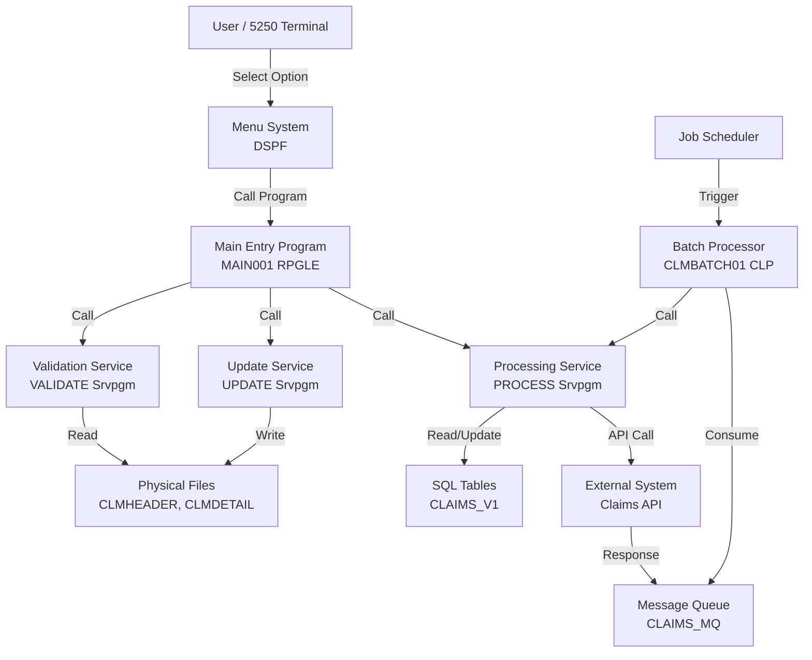
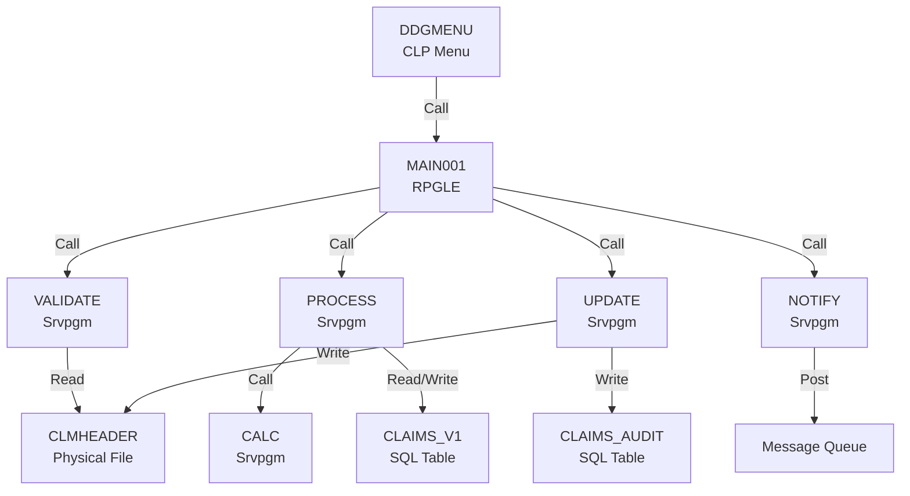
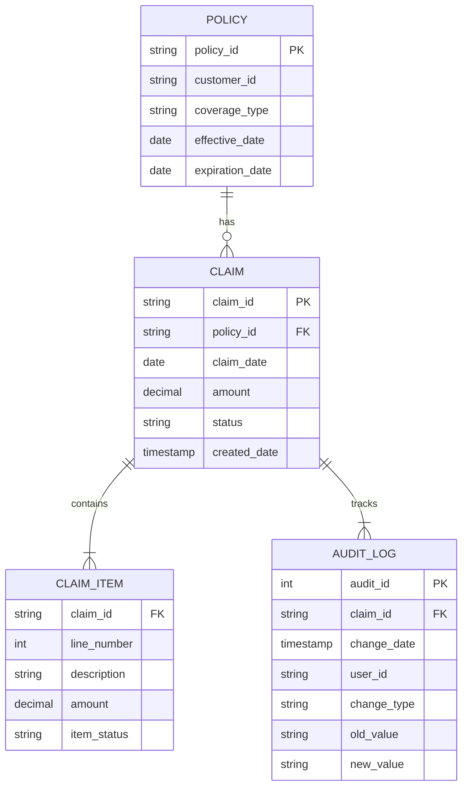
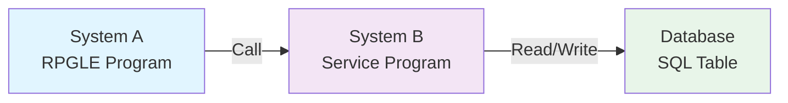

# IBM i Application Ecosystem Documentation — Authoritative Standards

**Purpose:** Document entire IBM i business processes and application ecosystems—not individual programs in isolation. Produce documentation that enables business stakeholders, developers, architects, support teams, and modernization engineers to understand system-wide context, dependencies, and business meaning.

**Audience:**
- Business stakeholders and business analysts
- Developers and technical architects
- Support analysts and operations teams
- Modernization teams and enterprise architects
- New team members and knowledge transfer candidates

---

## Part 1: Ecosystem Scope & Boundaries

### 1.1 Define the System

Answer these questions before starting documentation:

- **What is the business process?** (e.g., "Claims Processing", "Route Non-Payments", "Policy Administration")
- **Who uses it?** (internal staff, customers, batch processes, external systems)
- **What is the entry point?** (menu, command, scheduler job, API, web service)
- **What is the output?** (business result, data change, report, external system update)
- **How often does it run?** (interactive, batch nightly, scheduled, event-driven)

### 1.2 Document System Boundaries

Identify and list:

- **Internal components** — programs, files, service programs within scope
- **External dependencies** — systems outside the application boundary that are called
- **User interfaces** — 5250 screens, web UIs, APIs, reports
- **Data storage** — physical files, logical files, SQL tables, views, temporary tables
- **Integration points** — other systems, APIs, message queues, data queues, FTP, web services

**Include:** Dependency direction (inbound/outbound), criticality level, failure impact.

---

## Part 2: System Landscape Inventory

### 2.1 Component Inventory

Document all components using a structured table. For each component, include:

**IBM i Programs:**
- Member name (10-char max)
- Type (RPGLE, SQLRPGLE, COBOL, CBLLE, CL, CLLE)
- Description
- Purpose (entry point, service, utility, validation, reporting, integration)
- Frequency (batch nightly, interactive, one-time, scheduled)
- Owner/maintained by
- Last modified date

**UI Components:**
- File name (DSPF, PRTF)
- Description
- Associated programs
- User interaction model (subfile, detail-plus-list, wizard, form)

**Reports:**
- Report name (PRTF member)
- Purpose
- Data sources
- Frequency (scheduled, on-demand, triggered)
- Distribution

**Database Objects:**
- Physical Files (PF)
- Logical Files (LF)
- SQL Tables
- SQL Views
- Temporary work tables
- For each: name, type, record count [INFERRED/HIGH/MEDIUM], key structure, business meaning

**Service Programs & Modules:**
- Name
- Exported procedures/functions
- Purpose
- Binding directory

**APIs & External Interfaces:**
- API name or interface type
- Direction (inbound/outbound)
- Protocol (HTTP/REST, SOAP, ODBC, JDBC, Message Queue, Data Queue, FTP, native IBM i)
- Synchronous vs. asynchronous
- Failure impact

**Data Areas & User Spaces:**
- Name
- Type
- Contents and meaning
- Usage (read-only, read-write)
- Related programs

**Message Queues & Data Queues:**
- Queue name
- Queue manager (if MQ)
- Message format
- Producers/consumers
- Business meaning

**Batch Jobs & Scheduler Entries:**
- Job name
- Schedule (daily, weekly, monthly, ad hoc)
- Entry point program
- Job queue and library list
- Restart procedures

**Library List & Binding:**
- System library list configuration
- Product library list (production, test, development)
- Binding directories and dependencies

**Object & Authority Structure:**
- Authorization model (user groups, roles)
- Sensitive objects and access controls
- Audit requirements

### 2.2 Inventory Table Format

```markdown
## Component Inventory

| Category | Component Name | Type | Purpose | Status | Owner |
|----------|---|---|---|---|---|
| Program | MAIN001 | SQLRPGLE | Entry point for claims processing | Active | Claims Team |
| Service Program | VALIDATE | RPGLE Binding | Validation rules and business logic | Active | Claims Team |
| File | CLMHEADER | PF | Claims header records | Active | DBA |
| Table | CLAIMS_V1 | SQL Table | Claims data in SQL | Active | DBA |
| Display File | CLMSCREEN | DSPF | Interactive claims entry | Active | Claims Team |
| API | /claims/submit | REST | External claim submission | Active | Integration |
| Job | CLMBATCH01 | CLP | Nightly claims processing | Active | Operations |
| Scheduler | CLMBATCH01 | JobScheduler | Runs at 02:00 daily | Active | Operations |
```

---

## Part 3: Application Architecture

### 3.1 Architectural Style

Document the overall architectural pattern:

- **Monolithic** — single application handling all functionality
- **Modular** — distinct, loosely-coupled service modules
- **Layered** — clear separation of presentation, business logic, data access
- **Service-Oriented** — service programs providing reusable business functions
- **Batch-Oriented** — primarily scheduled/batch processing with optional interactive UI
- **Event-Driven** — triggered by messages, data queue events, or external APIs
- **Hybrid** — combination of patterns

### 3.2 Major Layers

Document the tier separation:

**Presentation Layer:**
- 5250 display files (DSPF)
- Interactive programs (RPGLE)
- Web UI (if applicable)
- APIs

**Processing/Business Logic Layer:**
- Service programs with business rules
- Validation procedures
- Calculation procedures
- Decision logic

**Data Access Layer:**
- File I/O procedures
- SQL access procedures
- Transaction management
- Commitment control

**Integration Layer:**
- External system calls
- Message queue interactions
- API calls
- Data transformation

**Batch/Scheduling Layer:**
- Job scheduler entries
- Batch processing programs
- Nightly jobs
- Reprocessing logic

### 3.3 Architecture Diagram

Provide a diagram showing major components and their relationships.

**Example (Mermaid):**



---

## Part 4: End-to-End Business Process Flow

### 4.1 Identify Entry Points

List all ways the system is invoked:

| Entry Point | Type | Trigger | Frequency | Owner |
|---|---|---|---|---|
| DDGMENU | Interactive Menu | User selection | Ad hoc | User |
| CLMBATCH01 | Scheduled Job | Nightly scheduler | Daily 02:00 | Operations |
| /claims/submit | REST API | External system | Event-driven | Integration |
| CLMREPROCESS | Manual Job | Operator command | As needed | Support |

### 4.2 Process Steps

For each major business process, document step-by-step flow:

**Process: Claims Entry and Submission**

```
Step 1: User selects "Enter Claim" from menu
  → Program invoked: MAIN001
  → Display file: CLMSCREEN
  → User action: Enter claim details

Step 2: Main program calls validation service
  → Program invoked: VALIDATE (service program)
  → Validates: Policy number, claim date, amount
  → Business rules applied: Claim must be within 30 days of occurrence
  → Output: Validation result (pass/fail, error messages)

Step 3: If validation passes, call processing service
  → Program invoked: PROCESS (service program)
  → Calculate: Claim deductible, coverage limits, payable amount
  → Apply: Business rules for coverage determination
  → Create: Claim record in CLAIMS_V1 table
  → Create: Audit trail in CLAIMS_AUDIT table

Step 4: Call update service to finalize
  → Program invoked: UPDATE (service program)
  → Update: CLMHEADER file with claim status
  → Insert: CLMDETAIL file with line items
  → Post: Message to CLAIMS_MQ for downstream processing

Step 5: Return control to user
  → Display: Confirmation screen with claim number
  → Write: Transaction log to IFS file for audit

Result: Claim is recorded in system and queued for processing
```

---

## Part 5: Program Dependency Analysis

### 5.1 Call Graph

Document who calls whom.

**Example:**

| Caller Program | Called Program/Srvpgm | Purpose | Dependency Type |
|---|---|---|---|
| MAIN001 (RPGLE) | VALIDATE (Srvpgm) | Validate user input | Mandatory |
| MAIN001 (RPGLE) | PROCESS (Srvpgm) | Apply business logic | Mandatory |
| MAIN001 (RPGLE) | UPDATE (Srvpgm) | Write to database | Mandatory |
| PROCESS (Srvpgm) | CALC (Srvpgm) | Calculate deductible | Mandatory |
| PROCESS (Srvpgm) | EXTERNAL_API | Verify policy with external system | Optional; failure = manual review |
| BATCH001 (CLP) | PROCESS (Srvpgm) | Nightly batch processing | Mandatory |

### 5.2 Dependency Diagram

Provide visual representation of program/service program dependencies.



---

## Part 6: Database Analysis

### 6.1 File/Table Inventory

For each physical file, logical file, and SQL table:

| Name | Type | Format | Records [est.] | Purpose | Access Pattern | Owner |
|---|---|---|---|---|---|---|
| CLMHEADER | PF | Fix-length 256 | [INFERRED] 500K | Claim header data | Keyed by claim# | Claims |
| CLMDETAIL | PF | Fix-length 512 | [INFERRED] 2M | Claim line items | Keyed by claim#/line | Claims |
| CLAIMS_V1 | SQL Table | Variable | [INFERRED] 500K | SQL view of claims | Indexed by claim# | Claims |
| CLAIMS_AUDIT | SQL Table | Variable | [INFERRED] 1M | Audit trail | Chronological, indexed by claim# | Audit |

### 6.2 Entity Relationship Summary

**Entities:**
- **CLAIM** — claim header (policy#, amount, date, status)
- **CLAIM_ITEM** — claim line items (claim#, line#, description, amount)
- **POLICY** — policy reference (policy#, customer#, coverage type)
- **AUDIT_LOG** — change tracking (claim#, timestamp, user, change_type, old_value, new_value)

**Relationships:**
- CLAIM → POLICY (many-to-one): Each claim references one policy
- CLAIM → CLAIM_ITEM (one-to-many): Each claim has multiple line items
- CLAIM → AUDIT_LOG (one-to-many): Each claim has audit entries



### 6.3 Read/Write Usage Analysis

For each file/table, document:

- **Read Operations:** Which programs read from this file? How often? What data is extracted?
- **Create/Insert Operations:** Which programs create records? Business trigger?
- **Update Operations:** Which programs update? Which fields change?
- **Delete Operations:** Is data deleted or archived? Conditions?

**Example:**

| File | Operation | Source Program | Frequency | Business Trigger |
|---|---|---|---|---|
| CLMHEADER | Read | MAIN001 | Per user request | User enters claim# to retrieve |
| CLMHEADER | Create | MAIN001 → UPDATE | Per claim submission | User submits claim form |
| CLMHEADER | Update | BATCH001 → PROCESS | Daily nightly | Claim status changes (approved/denied) |
| CLMHEADER | Read | BATCH001 → REPORT | Weekly | Generate weekly reports |

---

## Part 7: Business Rules Catalogue

Extract and document all identifiable business rules.

**Rule Format:**

| Rule ID | Rule Description | Source | Data Elements | Risk of Change | Notes |
|---|---|---|---|---|---|
| BR001 | Claim must be filed within 30 days of occurrence | Policy terms | claim_date, occurrence_date | HIGH | Fundamental eligibility rule |
| BR002 | Deductible applied to all claims | Policy coverage | amount, deductible, payable | HIGH | Financial impact |
| BR003 | No duplicate claims within 24 hours for same policy | Fraud prevention | claim_id, policy_id, timestamp | HIGH | Fraud detection |
| BR004 | Coverage limits enforced by coverage type | Policy limits | amount, coverage_type, limit | HIGH | Prevents overpayment |
| BR005 | Declined claims require manager approval to overturn | Approval rules | status, user_role, approver_id | MEDIUM | Controls approval authority |

**Categories:**

- **Validation Rules** — What data must be valid? What are acceptable ranges?
- **Approval Rules** — Who can approve? What conditions trigger approval?
- **Calculation Rules** — How is derived data calculated? (deductible, tax, commission)
- **Status Transition Rules** — What statuses are valid? What triggers transitions?
- **Eligibility Rules** — Who/what is eligible? What disqualifies?
- **Threshold Rules** — Are there amount or time thresholds?
- **Date/Time Rules** — Are there date calculations or time windows?
- **Security/Authorization Rules** — What access controls apply?

---

## Part 8: Batch Processing Analysis

### 8.1 Scheduled Jobs

Document all scheduled/nightly jobs:

| Job Name | Schedule | Entry Point | Library List | Job Queue | Restart | Owner |
|---|---|---|---|---|---|---|
| CLMBATCH01 | Daily 02:00 | CLMBATCH01 CLP | PRODLIB SYSLIB | BATCHQ | Manual restart supported | Operations |
| RPTWEEKLY | Weekly Monday 06:00 | RPTWEEKLY CLP | PRODLIB SYSLIB | BATCHQ | Automatic retry 3x | Operations |
| ARCHIVE | Monthly 1st 01:00 | ARCHIVE CLP | PRODLIB SYSLIB | BATCHQ | Manual retry only | DBA |

### 8.2 Batch Process Flows

For each scheduled job:

```
Job: CLMBATCH01 - Claims Processing
Schedule: Daily 02:00
Entry Point: CLMBATCH01 (CLP)

Steps:
1. Call PROCESS service program for each pending claim
2. Validate claim data (call VALIDATE srvpgm)
3. Calculate payable amount (call CALC srvpgm)
4. Update claim status in CLAIMS_V1
5. Post approved claims to payment queue
6. Generate batch report
7. Send completion notification

Error Handling:
- On validation error: Log to error queue, continue processing
- On database error: Log and skip record, continue
- On critical error: Abort job, send alert to operations

Recovery:
- Manual: Restart job with same parameters
- Automatic retry: None (manual restart required)
- Reprocessing: CLMREPROCESS job can re-run specific claim range
```

### 8.3 Failure Recovery

Document restart procedures:

- **Automatic Retry** — Does the system retry automatically? How many times? Backoff strategy?
- **Manual Restart** — How does an operator restart? From beginning or from last checkpoint?
- **Checkpoint/Restart Logic** — Are there committed checkpoints? Can processing resume?
- **Dead Letter Queue** — Where do failed records go? How are they handled?
- **Escalation** — Who is notified? What is the escalation path?

---

## Part 9: Interface Analysis

### 9.1 Interface Inventory

For each interface to external systems:

| Interface Name | Direction | Protocol | Format | Synchronous | Trigger | Failure Impact | Owner |
|---|---|---|---|---|---|---|---|
| EXTERNAL_POLICY | Inbound | ODBC Query | SQL Result Set | Sync | On-demand policy lookup | Blocks claims entry | Integration |
| CLAIMS_SUBMIT | Outbound | REST API | JSON | Async | After claim approval | Claims delayed; retry queue | Integration |
| PAYMENT_MQ | Outbound | IBM MQ | XML Message | Async | After payment approved | Payment delayed | Integration |
| NOTIFICATION | Outbound | SMTP | Plain text email | Async | On claim status change | Notification late; re-send manual | IT |

### 9.2 Interface Details

For each interface, document:

**Protocol & Format:**
- Communication protocol (HTTP/REST, SOAP, ODBC, JDBC, IBM MQ, Data Queue, FTP, File Drop)
- Message/data format (JSON, XML, CSV, fixed-length, native IBM i)
- Character encoding (UTF-8, EBCDIC, etc.)
- Compression (if applicable)

**Authentication & Security:**
- Authentication method (API key, OAuth, user/password, certificate)
- Encryption (TLS/SSL version, cipher suite)
- Authorization model (role-based, attribute-based)

**Failure Handling:**
- Timeout values
- Retry logic (immediate, exponential backoff, dead letter queue)
- Fallback behavior (queue, manual intervention, fail-fast)
- Logging and alerting

**Performance:**
- Expected latency
- Throughput capacity
- Rate limits (if applicable)
- SLA commitments

---

## Part 10: Security Analysis

### 10.1 Access Control Model

Document how access is controlled:

| Role | Allowed Operations | Object Access | Restrictions |
|---|---|---|---|
| Claims Entry Clerk | Create, read claim | CLMHEADER, CLMDETAIL | Can only view own claims |
| Claims Adjuster | Create, read, update claim | CLMHEADER, CLMDETAIL, CLAIMS_AUDIT | Full access |
| Manager | All adjuster + approve | All + approval queue | Can approve claims >$5K |
| Admin | Full | All objects | Audit trail required |

### 10.2 Sensitive Data Identification

| Data Element | Sensitivity | Protection | Storage | Audit |
|---|---|---|---|---|
| Social Security Number | PII / HIGH | Encrypted at rest, masked in logs | CLAIMS_V1, CLMHEADER | Full audit trail |
| Policy Number | Confidential | Access control | CLMHEADER | Role-based |
| Claim Amount | Internal | Access control | CLAIMS_V1 | Change tracking |
| User ID (who entered claim) | Internal | Access control | AUDIT_LOG | Full audit |

### 10.3 Audit & Compliance

Document audit trail requirements:

- **What is logged?** (create, update, delete, read sensitive data)
- **Who performed action?** (user ID, role)
- **When?** (timestamp, timezone)
- **What changed?** (old value, new value, field name)
- **Retention?** (how long is audit data kept?)
- **Access controls on audit data?** (who can view?)

---

## Part 11: Operational Support Guide

### 11.1 Daily Operations

Document what operations staff need to know:

**Daily Checks:**
- Are batch jobs completing successfully?
- Are there failed records in error queues?
- Are there any alerts or warnings?
- Are pending claim queues within acceptable limits?

**Common Failures & Resolution:**

| Symptom | Likely Cause | Recovery Steps | Prevention |
|---|---|---|---|
| CLMBATCH01 fails at step 2 | Database connection lost | Restart job; check DB; check firewall | Monitor DB availability |
| EXTERNAL_POLICY call times out | External system unavailable | Manual retry; use cached data if available | Increase timeout; implement retry logic |
| Payment queue backed up | Downstream system slow | Monitor downstream; escalate if >1 hour | Scale downstream capacity |

**Escalation Contacts:**
- **First Line:** Operations team - resolve common issues
- **Second Line:** Development team - debug application issues
- **Third Line:** DBA - resolve data/database issues
- **Fourth Line:** External systems owner - escalate interface issues

### 11.2 Monitoring & Alerting

Document what to monitor:

- Batch job completion times (alert if >X minutes)
- Claim processing throughput (claims/hour)
- Error queue depth (alert if >X records)
- Database size growth (alert if >X%)
- API response time (alert if >X ms)
- Claim status distributions (pending/approved/denied)

---

## Part 12: Technical Debt Assessment

### 12.1 Debt Identification

For each identified issue, document:

| Item | Type | Severity | Description | Impact | Effort | Priority |
|---|---|---|---|---|---|---|
| Hard-coded library names | Coupling | HIGH | DB library hard-coded in CL | Blocks portability between environments | 2 days | HIGH |
| No error handling in CALC srvpgm | Error Handling | MEDIUM | CALC program can fail silently | Data corruption risk | 3 days | HIGH |
| Duplicate code in 3 programs | Duplication | MEDIUM | Validation logic copied 3x | Maintenance burden; bug fixes needed 3x | 2 days | MEDIUM |
| No unit tests | Testing | MEDIUM | Service programs not tested | Regression risk | 5 days | MEDIUM |
| IFS file drop (legacy) | Integration | LOW | Still supporting FTP file drops | Obsolete; security risk | 1 day | LOW |

### 12.2 Debt Categories

- **Duplication** — Code copied instead of shared (consolidate to service program)
- **Hard-coding** — Library names, paths, constants (extract to configuration data area or .env)
- **Tight Coupling** — Programs calling program instead of service program (refactor to service program)
- **Obsolete Technology** — Old integration methods, deprecated APIs (modernize)
- **Lack of Error Handling** — Silent failures, no recovery (add error handling & logging)
- **Missing Auditability** — Changes not tracked; compliance risk (add audit trail)
- **Poor Performance** — N+1 queries, inefficient algorithms (profile & optimize)
- **Weak Testing** — No unit tests, no integration tests (add test coverage)

---

## Part 13: Modernization Assessment

### 13.1 Modernization Opportunities

For each opportunity, document impact (business value, technical value, effort):

| Opportunity | Category | Description | Business Value | Technical Value | Effort | Risk |
|---|---|---|---|---|---|---|
| Extract validation to shared service | Modularization | Consolidate duplicate validation logic into VALIDATE srvpgm | Faster claims entry; fewer bugs | Reduced technical debt; single source of truth | 3 days | LOW |
| REST API wrapper for claims submission | API Enablement | Wrap MAIN001 as REST API for web/mobile UI | Enable web UI; enable mobile app; external integrations | Microservices-ready; decoupled from 5250 UI | 1 week | MEDIUM |
| SQL-based reporting | Data Modernization | Replace fixed RPG reports with SQL views/materialized views | Faster report generation; flexible reporting | Query optimization; BI-ready; SQL analytics | 1 week | LOW |
| Unit test suite for PROCESS | Testing | Develop unit tests for PROCESS service program | Confidence in changes; regression prevention | CI/CD-ready; easier refactoring | 2 weeks | LOW |
| Git migration of source | DevOps | Migrate from QSYS source libraries to Git/IaC | Better version control; easier collaboration; CI/CD ready | Git workflow; automated deployments | 2 weeks | MEDIUM |
| Replace ODBC polling with event stream | Integration Modernization | Replace on-demand ODBC calls with event-driven notification | Lower latency; better throughput | Decoupled systems; event-driven architecture | 3 weeks | MEDIUM |

### 13.2 Migration Paths (Not Behavior Changes)

Document how each system component could be evolved without changing business behavior.

**Example — Extract Validation Logic:**
- Current: Validation code embedded in MAIN001
- Future: Validation extracted to VALIDATE service program
- Benefit: Reusable across MAIN001, BATCH001, REST API
- Business Impact: None (same validation rules applied)
- Technical Benefit: Reduced code duplication, easier testing, easier maintenance

---

## Part 14: Risks & Assumptions

### 14.1 Operational Risks

| Risk | Probability | Impact | Mitigation |
|---|---|---|---|
| Database connection lost during batch | Medium | CLMBATCH01 fails; claims not processed | Implement automatic retry; monitor DB availability; escalation procedure |
| External policy system unavailable | Low | Can't verify policies; manual workaround | Cache recent policies; implement fallback; external SLA commitment |
| Payment queue filled up | Medium | Payments delayed; customer impact | Monitor queue depth; scale downstream; escalation |
| Claim record corruption | Low | HIGH | Implement checksums; audit trail; recovery procedure |

### 14.2 Knowledge Risks

| Risk | Probability | Impact | Mitigation |
|---|---|---|---|
| Business rules not fully documented | High | Future changes may violate business intent | Document all BR* rules; require SME review of changes |
| PROCESS service program not understood | Medium | New dev can't maintain; bug fixes risky | Create documentation; pair programming; unit tests |
| Batch job restart procedure unclear | Medium | Failed batch not recovered; claims lost | Document restart procedure; test recovery; train operations |
| External system integration undocumented | Medium | Integration breaks when external system changes | Document integration; versioning; change notification process |

### 14.3 Dependency Risks

- **External System Dependency** — claims submission blocked if external policy system unavailable
- **Database Dependency** — all claims processing blocked if database unavailable
- **Network Dependency** — REST API and message queue require network connectivity
- **Library Dependency** — service programs in PRODLIB required; if missing, all claims stop

### 14.4 Security Risks

- **PII Exposure** — SSN stored in multiple locations; improper access could expose data
- **Audit Trail Gap** — not all updates logged; compliance risk
- **Access Control Weakness** — role-based access not enforced in all programs
- **Secret Management** — API keys/passwords hard-coded or poorly protected

### 14.5 Modernization Risks

- **Breaking Change Risk** — refactoring service programs without comprehensive tests
- **Performance Risk** — switching from fixed-length files to SQL tables without tuning
- **Data Migration Risk** — moving from QSYS files to SQL; data mapping errors
- **Integration Risk** — replacing batch file drops with event streams; timing/ordering changes

---

## Part 15: Knowledge Transfer Guide

### 15.1 For New Team Members

**What to learn first:**

1. **Business Process** — Read the end-to-end process flow section (Part 4). Understand claim entry, processing, and approval flow.
2. **Program Entry Points** — Understand MAIN001 (interactive) and CLMBATCH01 (batch). These are the main system entry points.
3. **Service Programs** — Understand VALIDATE, PROCESS, UPDATE service programs. These implement core business logic.
4. **Database Schema** — Understand CLMHEADER, CLMDETAIL, CLAIMS_V1. These hold the claim data.
5. **Business Rules** — Study the Business Rules Catalogue (Part 7). Understand eligibility, deductibles, coverage limits.

**Critical Programs:**

- **MAIN001** — Claims entry; if broken, interactive users blocked
- **CLMBATCH01** — Nightly processing; if broken, claims not processed
- **PROCESS** — Business logic; contains most complex calculations
- **VALIDATE** — Data validation; prevents bad data in system

**Critical Files/Tables:**

- **CLMHEADER** — All claims indexed here; data corruption critical
- **CLAIMS_V1** — SQL view of claims; used for reporting
- **CLAIMS_AUDIT** — Audit trail; required for compliance

**Critical Dependencies:**

- **External Policy System** — Claims can't be entered without policy verification
- **Payment Queue** — Claims sit in queue until payment system processes
- **Database** — All claims processing blocked if DB unavailable

### 15.2 On-Boarding Path

**Week 1 — Understanding:**
- Read business process documentation
- Read application architecture
- Review program call graph
- Trace one claim from entry to approval (manually walk through code)

**Week 2 — Technical Exploration:**
- Walk through MAIN001 code; understand entry point
- Walk through VALIDATE service program; understand validation
- Walk through PROCESS service program; understand processing
- Review database schema; run sample queries

**Week 3 — Hands-On:**
- Set up development environment
- Compile and run test programs
- Create test claim in development
- Trace through batch processing
- Review batch log and audit trail

**Week 4 — Support Readiness:**
- Shadow production support on batch job monitoring
- Study common errors and recovery procedures
- Practice batch job restart procedure
- Review escalation procedures

---

## Part 16: SME Questions

List questions that require subject matter expert input to complete documentation.

**Format:**

| Question | Subject Area | Why It Matters | Impact if Unanswered |
|---|---|---|---|
| What is the policy on claim denials? Can adjuster override? | Business Rules | Determines approval workflow; security controls | Can't document approval rules; risk of unauthorized approvals |
| How long are claims retained in database? | Data Retention | Archive/purge strategy; storage planning | Can't plan capacity; may lose historical data |
| Are there SLAs on claim processing? | Operations | Service level targets; monitoring thresholds | Can't set meaningful alerts; can't monitor SLA compliance |
| What external systems must be notified when claim status changes? | Integration | Downstream systems; data consistency | Can't document integration points; might miss data syncs |
| Who are the current SMEs for this application? | Team | Knowledge transfer; escalation | Can't maintain code if SMEs unavailable |

---

## Documentation Standards

### Markup & Notation

- **[INFERRED]** — Information not directly observable; sourced from code analysis, logs, or inference. Always include confidence level: HIGH/MEDIUM/LOW.
- **[MANUAL]** — Information verified through manual inspection or testing.
- **[DOCUMENTED]** — Information from official documentation or comments in code.
- **[ASSUMED]** — Information assumed but not verified. Flag for SME confirmation.

### Diagram Standards

Use Mermaid for all architecture and flow diagrams. Include:
- Component/entity names
- Relationship labels (calls, reads, writes, triggers)
- Directional arrows showing data/control flow
- Legend if using specialized symbols

### Diagram Examples



---

## Documentation Maintenance

### Update Triggers

Update this documentation when:
- Major business process changes
- New programs or service programs added
- Database schema changes
- Integration points added or modified
- Business rules change
- Performance issues identified
- Security issues identified
- Batch job schedule changes

### Review Cycles

- **Quarterly** — Review end-to-end process for accuracy
- **Semi-annually** — Review component inventory; update status
- **Annually** — Full documentation review; update architecture diagrams
- **Post-release** — Update after major releases
- **Post-incident** — Update after production incidents to document root cause and recovery

---

## See Also

- `enterprise-grade-program-documentation.instructions.md` — For individual program documentation
- `modernizing-ibmi-applications.instructions.md` — For modernization strategies
- `ibmi-ferraria-standards.instructions.md` — For naming conventions
- `performance-optimization.instructions.md` — For performance tuning
