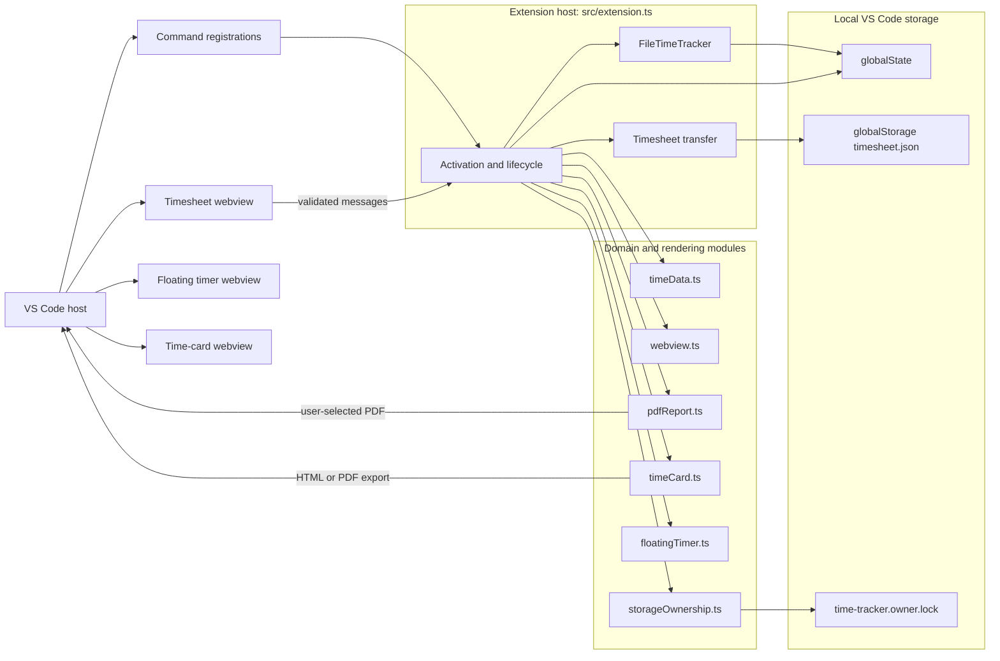

## Diarium Architecture

Diarium is a local-first Visual Studio Code extension. It has no application server, account, telemetry,
or remote runtime. VS Code APIs provide activation, commands, webviews, status display, dialogs, and
extension storage.

### Component view

### Runtime boundaries

- `src/extension.ts` owns activation, command routing, storage, ownership, panel lifecycle, and cross-component
  coordination.
- `src/fileTimeTracker.ts` owns automatic file intervals and cumulative totals. It uses in-memory timing
  anchors and serializes writes.
- `src/timeData.ts` validates manual entries, holidays, dates, times, periods, and Outlook `.ics` events.
- `src/webview.ts` builds the main Timesheet panel and validates or drafts webview state.
- `src/pdfReport.ts` and `src/timeCard.ts` render report and card exports.
- `src/floatingTimer.ts` displays one snapshot-based timer view.
- `src/storageOwnership.ts` provides the single-host lock for shared stores.

### Data flows

#### Manual timesheet

1. The Timesheet webview sends a typed message for entry, holiday, filter, period, or report action.
2. The extension host validates the request and updates the in-memory state.
3. The host serializes the manual store to `timesheet.json` in global storage.
4. Open Timesheet panels receive synchronized state updates.

Manual entries and preferences are separate from automatic file activity.

#### Automatic file activity

1. Activation settles the current file, checks VS Code focus, and resolves the active local file.
2. Active-editor and window-focus events call `FileTimeTracker.setActiveFile()`.
3. The tracker settles elapsed time, starts eligible intervals, and exposes snapshots.
4. A 60-second checkpoint persists totals. A one-second display timer refreshes views without writing.
5. Pause, exclusion, reset, and orderly deactivation settle or persist state through the tracker.

Tracking uses `node:perf_hooks` in the extension host. It does not read file contents and it does not
monitor applications outside VS Code.

#### Storage

| Store | Location | Contents |
|---|---|---|
| Manual timesheet | `globalStorageUri/timesheet.json` | Entries, period, hourly rate, holidays |
| Automatic activity | `context.globalState.time-tracker.file-activity` | Version 1 cumulative totals and exclusions |
| Legacy activity | `context.globalState.fileTimers` | Unmerged legacy totals, preserved only |
| Ownership lock | `globalStorageUri/time-tracker.owner.lock` | Process and random ownership token |

One extension host owns the shared stores at a time. Failure to acquire the lock disables Time Tracker commands
for that host and offers reload or lock recovery. Older `time-tracker.data` state is read only as a migration
source for the manual timesheet file.

### Shared snapshots

Status bar, Timesheet File activity view, Maintenance status, floating timer, and time cards derive totals
from `FileTimeTracker.snapshot()`. The card is an explicit snapshot: refresh replaces the snapshot, while
exports use that displayed snapshot.

### Export boundaries

- Timesheet JSON export contains manual entries and public holidays only.
- Import validates the complete envelope and merges entry IDs and holiday values without replacing local period
  or hourly rate.
- Outlook `.ics` import is exposed from the Maintenance Timesheet data card. It creates manual entries after
  a user confirmation; it does not affect file activity.
- HTML and PDF card exports contain file basenames, durations, and percentages; they omit directory paths.
- Timesheet PDF and card PDF generation remain local. Unsupported PDF characters produce an actionable error.

### Panel lifecycle

- The main Timesheet panel can have multiple open instances. Panel disposal removes only that view listener.
- The floating timer uses one shared panel instance and can move within VS Code.
- The time-card panel owns a refreshable snapshot and export message listener.
- Deactivation stops checkpoints and displays, settles active file time, awaits pending manual writes and loads,
  and releases the ownership lock.

### Active and legacy modules

The active entry point imports the modules documented above. `src/excludeFiles.ts`,
`src/timeTrackerProvider.ts`, and `src/timeCardGenerator.ts` remain in the working tree but are not wired into
the active extension entry point. They are legacy reference code, not active architecture.
